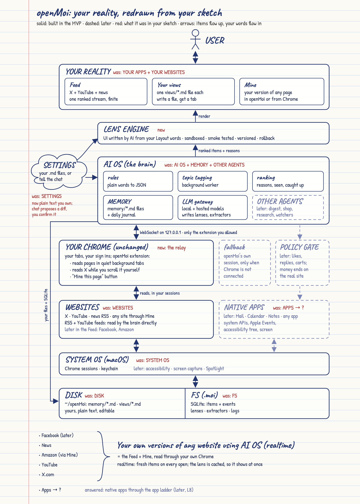

# openMoi: your reality

Design doc · draft v3 · Nov 11, 2026 · owner: srikar

**How to read this doc.** Part 1 is the MVP: the first thing we build, small and real, enough to taste the promise. Part 2 is everything later. It stays here so the MVP's bones point the right way, not so we build it now. Part 3 is a proposal: scenarios that make the vision real for a user and the gaps between them and this design.

**Status tags** on sections: `[built]` done and tested, `[partly built]` some of it shipped early, `[not built]`, `[proposed]` new and not yet agreed.

## Contents

Shared

1. Summary
2. Principles
3. From the sketch to this design
4. Target design (full HLD)

Part 1: MVP `[built]`

5. What the MVP must prove `[built]`
6. Scope: in and out `[built]`
7. MVP architecture `[built]`
8. The bones `[built]`
9. MVP components `[built]`
10. MVP flows `[built]`
11. MVP data and contracts `[built]`
12. MVP guardrails `[built]`
13. Milestones `[M1 to M3 built]`
14. Simplicity budget
15. What got simplified and why

Part 2: Later

16. Later stages map
17. L1 Robust reading `[built]`
18. L2 Smarter brain `[built]`
19. L3 Full lens engine `[built]`
20. L4 Intent views `[built]`
21. L5 Actions and the policy gate `[built]`
22. L6 Agents `[not built]`
23. L7 Recipes and mashups `[not built]`
24. L8 Native apps and System OS `[not built]`
25. L9 Launch hardening `[not built]`
26. Cross cutting: security, compliance, privacy, budgets, testing `[partly built]`
27. Tech stack and decisions
28. Repo layout
29. Risks
30. Open questions
31. Beyond

Part 3: Your reality, your terms `[built]`

32. Vision
33. Scenarios
34. Gaps
35. Changes to this design
36. Order

# Shared

## 1. Summary

openMoi is a facade over the web you already use. A small extension lets it read pages in your own Chrome, inside the sessions you are already logged in to; Chrome itself works exactly as before. openMoi turns what it reads into structured items, filters and ranks them with what it knows about you, then shows them in its own window through UIs generated for you. The original site stops being the interface and becomes a data source.

Views are organized by intent instead of by site: one Feed merges X, YouTube and news; later one Shop compares Amazon with any other store.

Three ideas carry the design:

1. **Generate the renderer, not the page.** LLMs write extractors and UI code once. Every request after that runs cached, deterministic code on fresh data, which keeps it fast, cheap and stable.
2. **One adapter ladder for everything.** Any website or app becomes read and write capabilities reached through the best available rung: API, structured data, DOM, accessibility tree, screen.
3. **Your device, your session, your pace.** No servers fetch on anyone's behalf, nothing runs beyond human scale and nothing evades a site's defenses.

The MVP (Part 1) proves this with a Feed across X, YouTube and news, views and memory as plain .md files, layouts generated by asking and a "Mine" toggle that gives you your own version of any page.

## 2. Principles

| # | Principle | Consequence in the design |
|---|---|---|
| 1 | Intent over site | Views merge sources; a per site copy is only the "Mine" fallback |
| 2 | Generate the renderer, not the page | Lenses and extractors are generated once and cached; LLMs stay off the hot path |
| 3 | One ladder | Same adapter contract for feeds, web pages and, later, native apps |
| 4 | Local first | Sessions, items, memory and caches live on your disk; hosted models see structure, not your content, by default |
| 5 | Your device, your session, your pace | Reads on your action or on a schedule you wrote, fixed budgets, stop on challenge, no proxies, no fingerprint games |
| 6 | Reads free, writes gated | MVP is read only; later every write passes one gate and money always ends on the real site |
| 7 | Content is data, never instructions | Web text can never trigger an action or change your files |
| 8 | Inspectable and reversible | Your rules, memory and views are files you can read; reasons on every item; lens versions; show original |
| 9 | Simplest thing first | The first iteration of every part uses the plainest mechanism that works; structure is added only when a real limit is hit |

## 3. From the sketch to this design

| Sketch box | Becomes | Why it changed |
|---|---|---|
| USER | User | Same |
| YOUR APPS / YOUR WEBSITES | Views rendered by lenses, plus "Mine" for any page | One surface per intent instead of a copy per site |
| SETTINGS (cloud) | Plain .md files you edit by hand or change by chat | Settings, rules and memory are one thing: text you own |
| AI OS + MEMORY + OTHER AGENTS | Brain: compiles your files, tags, ranks, generates lenses and extractors; agents later | Same role with explicit boundaries |
| (not in sketch) | Lens | Generated UI code, cached, so "realtime" never means regenerating each page |
| (not in sketch) | Policy gate (later) | Every write passes one checkpoint |
| APPS / WEBSITES | Source adapters plus the real sources | One ladder: feeds, structured data, DOM, accessibility tree, screen |
| SYSTEM OS (left loop) | Chromium sessions in the MVP; keychain, accessibility, screen capture, Spotlight later | The side channel becomes explicit and permissioned |
| DISK / FS | `~/openMoi/` folder of .md files plus a small SQLite file | Local first |
| "Apps -> ?" | App ladder (L8): system frameworks, Apple Events, accessibility tree, screen | Answered by the same extractor approach used for websites |

## 4. Target design (full HLD)



The picture above is the original sketch redrawn: red notes say what each box was, solid boxes are built and dashed ones come later. Its source is `docs/hld.html`.

This is where the design ends up. The table below the diagram says what the MVP builds.

Items flow up from sources to views. Actions (later) flow down from views through the gate to sources.

```
                                    USER
                                      |
                                      v
  .-----------.   +------------------------------------------------------+
 (  SETTINGS   )  |            INTENT VIEWS  (your reality)              |
 ( .md files,  )  |   Feed    Shop    Watch    Read    Chat    Files     |
 ( chat edits  )  +--------------------------+---------------------------+
  '-----+-----'                              ^                  show original:
        |                                    | render           raise the real
        |         +--------------------------+--------------+   page, any time
        +-------->|                LENS ENGINE              |
        |         |  generated UI code per view             |
        |         |  sandboxed, tested, cached, versioned   |
        |         +--------------------------+--------------+
        |                                    ^ ranked items up, actions down
        v                                    |
  +-----+------------------------------------+--------------------------+
  |                       BRAIN   (the "AI OS")                         |
  |                                                                     |
  |  user model     memory        ranking          agents     LLM       |
  |  rules +        .md files     dedupe, cluster, digest,    gateway   |
  |  learned        topics +      score, explain,  shop,      local +   |
  |  weights        journal       caps             research   hosted    |
  +-----+-----------------------------+---------------------------+-----+
        | read                        | write                     | side channel
        v                             v                           | files, calendar,
  +-----+------------------------+  +-+------------------------+  | contacts, search
  |      SOURCE ADAPTERS         |  |       POLICY GATE        |  |
  |  best rung wins:             |  |  tier, origin, caps,     |  |
  |   1 API, RSS, data export    |<-+  confirm in shell,       |  |
  |   2 structured data          |  |  verify, audit           |  |
  |   3 DOM extractor            |  +--------------------------+  |
  |   4 accessibility tree       |                                |
  |   5 screen + vision          |                                |
  +-----+-------------------+----+                                |
        |                   |                                     |
        v                   v                                     |
  +-----+----------+  +-----+-----------------+                   |
  |   WEBSITES     |  |     NATIVE APPS       |                   |
  |  your sessions |  |  Mail, Calendar,      |                   |
  |  your device   |  |  Notes, any app       |                   |
  +-----+----------+  +-----+-----------------+                   |
        |                   |                                     |
        v                   v                                     v
  +-----+-------------------+-------------------------------------+-----+
  |                      SYSTEM OS  (macOS first)                       |
  |  Chromium sessions   keychain   accessibility   screen   Spotlight  |
  +----------------------------------+----------------------------------+
                                     |
  +----------------------------------+----------------------------------+
  |  DISK / FS  (local first)                                           |
  |  ~/openMoi: memory/*.md  views/*.md  lenses  extractors             |
  |  SQLite: items, events (more tables only when a stage needs them)   |
  +---------------------------------------------------------------------+
```

| Box | MVP | Later |
|---|---|---|
| Intent views | Feed, any number of your own views (one .md file each), "Mine" for any page | Read, Watch, Shop, Chat, Files (L4) |
| Settings | .md files plus chat edits | Same |
| Lens engine | One HTML file per view, sandboxed, smoke tested, numbered versions | Full pipeline (L3) |
| Brain | Compile .md, tag topics, rules, simple ranking, lens and extractor generation, LLM gateway | Learned ranking, clusters (L2), agents (L6) |
| Source adapters | Rung 1 (RSS, YouTube RSS) in the brain; rung 3 (DOM specs) and Readability in your Chrome through the relay | Rung 2 (L1), rungs 4 and 5 (L8) |
| Policy gate | not built: read only | L5 |
| Websites | X, YouTube, RSS feeds; any site's feed page as a source that reads ahead as you scroll; any page in your Chrome or in openMoi through "Mine" | Facebook and Amazon tested as Feed sources (L1) |
| Native apps | not built | L8 |
| System OS | Chromium sessions only | Keychain, accessibility, screen, Spotlight (L8) |
| Disk / FS | `~/openMoi/` plus SQLite with 2 tables | More tables as stages need them |

# Part 1: MVP `[built]`

## 5. What the MVP must prove `[built]`

Five moments. If a user feels these, the promise is real:

1. **One feed, many sites:** X, YouTube and news in one stream without opening any of them.
2. **It obeys plain words:** "no shorts, hide politics, Maya first" just works, typed in chat or written in a file.
3. **The UI is yours:** "make it a two column magazine" changes the layout in about a minute.
4. **Your version of any page:** a "Mine" toggle turns any article or listing page (a blog, Hacker News, Amazon search) into a clean view.
5. **It knows you, visibly:** memory and view definitions are .md files you can open, read and edit.

Not a goal for the MVP: being safe to hand to strangers. It is a dogfood build for the team and a few friendly testers, run from source.

## 6. Scope: in and out `[built]`

| In the MVP | Out (where it goes later) |
|---|---|
| Electron shell with tabs and your own sessions | Packaging, signing, auto update (L9) |
| Python brain on localhost HTTP | Unix socket RPC, schema codegen, supervisor (L9) |
| Sources: X home timeline, YouTube channels through RSS (the channel's videos page when YouTube's feed server is down, which happens for hours at a time), any RSS feed, any site's feed page (`Page:`) read ahead in a reader tab | Facebook and Amazon tested as sources, passive JSON capture, assist mode (L1) |
| "Mine" for any page: Readability for articles, generated extractor for listings | Page classifier with many types, structured data paths, health monitor, packs (L1) |
| Views as .md files: sources, rules, layout in plain words | Match kinds beyond union, identity links (L7) |
| Memory as .md files | Journal rollups, vectors (L2) |
| Rules compiled to flat JSON, topic tagging, simple ranking with reasons, seen and "caught up" | Learned weights, clusters, embeddings, explore slot (L2) |
| Generated lens: one HTML file, sandbox, smoke test, numbered versions | Visual judge, patch mode, media proxy, full test gate (L3) |
| Chat panel: every change is a .md edit you confirm | Chat Q&A over your history (L4) |
| Read only: act through "open original" | Gate, actions, executors (L5) |
| | Agents (L6), native apps (L8) |

## 7. MVP architecture `[built]`

```
                                      USER
                                        |
  +-------------------------------------+   +--------------------------------+
  |  YOUR CHROME  (unchanged)           |   |  openMoi WINDOW  (Electron)    |
  |   your tabs, your sessions          |   |   view tabs   Mine pages       |
  |   openMoi extension:                |   |   chat panel  notices          |
  |    page operations in your tabs     |   |   lens views (sandboxed HTML)  |
  |    background reads, grouped        |   |   fallback: its own session    |
  |    passive reads, Mine button       |   +---------------+----------------+
  +-----------------+-------------------+                   |
                    | WebSocket 127.0.0.1:47321              | localhost HTTP
                    v                                        v
  +-----------------+----------------------------------------+---------------+
  |  BRAIN  (Python, sync)                                                   |
  |   relay hub (approved extension only)    compile .md -> JSON             |
  |   ingest   tag   rules + rank   rung 1 feeds   LLM gateway (2 slots)     |
  |   lens generator   extractor generator                                   |
  +-----+--------------------+-------------------------+---------------------+
        |                    |                         |
        v                    v                         v
   ~/openMoi/            .moi/openmoi.db           models
    memory/*.md           items, events             fast: local server
    views/*.md                                      smart: hosted API
    .moi/ compiled, lenses, extractors, logs
```

* Three things we write: the openMoi window (TypeScript), the Chrome extension (TypeScript, sharing the page operation code) and the brain (Python). Models run outside them: a local model server for the fast slot, a hosted API for the smart slot.
* The window drives every page read through a page driver: your Chrome through the relay whenever the extension is connected, openMoi's own hidden views only as a fallback.
* Once you have paired Chrome, a read waits up to 35 s for it to reconnect (the extension wakes on a 30 s alarm) instead of falling back to openMoi's session, which is signed in nowhere. If a read did fall back and hit a sign in, it runs again in Chrome the moment Chrome connects and its notice is withdrawn with the first items.
* Infinite scroll with your filter (`readers.ts`, `views.ts`): every page source has one reader tab, kept open in your Chrome (or openMoi's session) where it last stopped:

      you scroll the view -> the lens reports what is on screen -> fewer than 20 filtered items left below the furthest you saw
        -> raw items needed per source = what refills the view to 30 / the share of that source the rules let through (the brain reports it)
        -> its reader tab scrolls on at human pace (the source's interval plus up to half again), extracting after every step
        -> new items -> brain tags, filters and ranks -> appended below -> repeat
      a refresh starts sources from the top; 3 scrolls with nothing new -> that source ended -> "caught up" once all have
      daily scroll budget per source (200 steps) used -> stops for today; a tab idle for 10 minutes closes; at most 4 tabs
      no saved extractor -> one is written from the page skeleton the first time, then kept
      openMoi quit -> the extension closes its reading tabs after a minute
* The window calls the brain; the brain never calls the window. Anything that needs a browser (running an extractor, smoke testing a lens) runs on the window's side, which sends the result back in its next request.
* RSS and YouTube feeds are public feeds meant for machines, so the brain fetches them directly. X and every `Page:` source are read in your Chrome: one reader tab each in a collapsed "openMoi" group, kept open while you scroll and closed after 10 idle minutes.

## 8. The bones `[built]`

The few decisions later stages build on. These must be right in the MVP; everything else may be rough.

| Bone | MVP form | What plugs into it later |
|---|---|---|
| Item | One normalized item model for every source | Every source, view, ranking model and agent |
| Source adapter | `read()` returning raw records, tagged with its rung | New rungs and sources (L1, L8), actions (L5) |
| View as a .md file | Sources, rules and layout in plain words, compiled to JSON | Mashups and match kinds (L7), shared views |
| Lens contract | Small message set between host and a sandboxed lens | Full lens engine (L3), actions (L5) |
| Shell and brain split | One HTTP API; the shell executes, the brain thinks | Gate in the shell (L5), agents in the brain (L6) |
| LLM gateway | Every model call goes through one module with a call log | Privacy modes, budgets, caching (L9) |
| Files you own vs machine state | `~/openMoi/` for .md files; `~/openMoi/.moi/` for everything generated | Sync, export, sharing |
| Event log | Every open, seen and "less like this" recorded from day one | Learned ranking trains on real history (L2) |
| Read only boundary | Items carry `available_actions`; no executor exists | The gate adds executors at one point (L5) |
| Page driver | `open`, `run` a page operation, `url`, `close`; your Chrome through the relay, or openMoi's own session | Native apps as one more driver (L8); actions run through the same driver (L5) |

## 9. MVP components `[built]`

### 9.1 Shell (Electron, TypeScript)

* One window: a top bar (view tabs, one per `views/*.md`; web tabs; URL bar; "Mine" toggle; refresh), a main area (a lens or a web tab) and a chat panel on the side.
* All web tabs and source views share one persistent session (`persist:web`), so you sign in to X once, like any browser.
* Source pages are read in reader tabs in your Chrome (9.8). Without the extension, openMoi's own driver loads them in views attached behind the lens with `backgroundThrottling: false`, the fallback the M1 spike chose.
* Preload script in an isolated world with three small pieces: the extraction interpreter (runs a JSON spec against the DOM), the skeletonizer (9.6) and Mozilla Readability.
* Pilot reads: only when you open, refresh or scroll near the end of a view; each source's reader tab moves on at its pace (1.5 s between scrolls plus up to half again), automatic reads of a source at most once every 10 minutes, at most 200 scroll steps per source a day.
* Challenge stop: on a login wall, CAPTCHA or checkpoint, stop reading that source, show you the real page and retry only when you press refresh.
* Standard Chromium user agent; no spoofing of any kind.
* Security baseline: `contextIsolation`, `sandbox`, no `nodeIntegration` in web content.
* Starts the brain with `uv run --project brain python -m moi_brain` on a free local port with a per launch token; restarts it if it exits.

### 9.2 Sources

| Source | How | Rung |
|---|---|---|
| RSS / Atom | Brain fetches with `feedparser` using conditional GET | 1 |
| YouTube | Channel RSS feeds; channels listed in the view file by @handle (resolved to a channel id once, cached) or imported from a Takeout `subscriptions.csv` | 1 |
| X | Handwritten extractor spec for the home timeline, run in a reader tab in your Chrome (or openMoi's session) | 3 |
| Any website ("Mine") | Readability for articles; generated extractor spec for listings | 3 |
| Any site's feed page (`* Page: <url>` in Sources) | A reader tab that keeps scrolling as you do: Instagram, Facebook, a YouTube home, any listing; its extractor is generated from the page the first time. `(newest first)` after the address marks a page whose posts come in order, read until it reaches what was read before (34.6) | 3 |
| A page you watch (`* Watch: <url> [every 30 minutes]` in Sources) | Looked at about hourly (never more often than every 5 minutes) in a quiet tab that closes again; a change becomes the page's one change item, and an alert when a view's rules keep it (34.6) | 3 |
| Who you follow (`* Following: <url>` in Sources) | A page listing the accounts you follow, read about once a week into who you know (34.4); never shown as items | 3 |

### 9.3 Brain (Python 3.12, sync)

* FastAPI with plain `def` handlers (no async code), bound to 127.0.0.1, every request carrying the launch token (compared in constant time) and naming 127.0.0.1 as its host, so a web page rebinding a domain to your machine is turned away. State and cache files are written atomically and a damaged one is rebuilt.
* SQLite through the standard `sqlite3` module; two tables (11.2).
* Ingest: raw records -> Item, canonical URL with tracking params stripped, dedupe by source id plus native id and by canonical URL.
* Tagging: new items are stored at once and queued; a background worker sends batches of 10 to the fast model, which picks topics from the watch list (a few common topics plus every topic your rules and memory name). Tagging against a closed list keeps tags and rules in sync. The same call answers the judgments a view's rules declare (34.3). A view with topic rules shows only tagged items (unless tagging is paused), so nothing you asked to hide slips through while a slow local model catches up. `media_kind` comes from the source (YouTube shorts, X video), not the model.
* Compile: `views/<view>.md` + `memory/likes.md` + `memory/dislikes.md` -> compiled JSON (11.4), validated by pydantic, cached by file hash. A failed compile keeps the previous version and shows the error in chat.
* Ranking: drop hidden items and items you saw more than 12 hours ago (so a reload or a new look shows the same feed), apply limits, score = recency decay × source weight + boosts, sort, pages of 30. Each item carries plain reasons ("boost: Maya", "recent").
* Rung 1 refresh runs in a background thread; views serve cached items while it runs.
* Journal: every `open` event appends one line to today's journal file.

### 9.4 Everything you own is a .md file

```
~/openMoi/
  memory/
    MEMORY.md          index, one line per file
    about_me.md        facts you told it
    likes.md           global boosts in plain words
    dislikes.md        global hides in plain words
    people.md          who matters, with handles per source
    journal/
      20261104.md      one line per thing you opened
  views/
    feed.md            sources, rules, layout for the Feed
    tech.md            a second view is just a second file
    site_amazon.com.md created the first time you customize a Mine page
  .moi/                machine state, safe to delete and rebuild
    config.json        model slots, privacy switch
    compiled/          feed.json, tech.json
    lenses/            feed/v1.html, feed/v2.html, feed/current.json
    extractors/        news.ycombinator.com.json, amazon.com_s.json
    openmoi.db         items, events
    logs/              brain.log, llm_calls.jsonl
```

A view file:

```markdown
# Feed

## Sources
* X home timeline
* YouTube: @veritasium, @3blue1brown, @mkbhd
* RSS: https://feeds.arstechnica.com/arstechnica/index
* RSS: https://www.theverge.com/rss/index.xml

## Rules
* No shorts.
* Hide politics unless it comes from Ars Technica.
* At most 20 posts from X a day.
* Posts from @maya always first.

## Layout
Two column magazine, big images, no like counts, dark theme.

## Time
* Editions at 7:00 and 18:00.
* Each edition has 15 items.
```

A memory file:

```markdown
# dislikes

* Crypto price talk.
* Celebrity gossip.
* Rage bait about phones.
```

Memory rules:

* Read whole into prompts: MEMORY.md, the topic files and the last 14 days of journal. Small by design.
* Topic files change only after you confirm a proposed edit. Web content writes only to the journal, as quoted data with a link (34.5).
* Hand edits are picked up on the next read.
* Backup is copying `~/openMoi/`.

### 9.5 Lens

* One self contained HTML file per view version, loaded as its own document in a dedicated sandboxed view. The host puts a CSP first in its head; a preload exposes the `moi` helper (11.6), the only thing a lens can call.
* Sandbox: the lens view has its own session that loads nothing but its document and the https images of items it was sent (an "image" whose address carries your items elsewhere is refused), enforced by the session and by the CSP `default-src 'none'; script-src 'unsafe-inline'; style-src 'unsafe-inline'; img-src https: data:`, which comes first in every lens document. It cannot navigate or open windows; every message it sends is validated before the host acts on it; opening an item or "less like this" needs your click or key press and comes at most at the pace of clicks. The smoke test fails a lens that tries to load anything else.
* Generation (smart slot): input is the view's Layout text, the item model, the helper API and the matching default lens as an example; output is one HTML file.
* Smoke test (shell, hidden window): render 30 synthetic items covering every kind, missing fields and long text; expect `ready`, every item id present in the DOM as `data-item-id` and no script errors. One retry with the error attached; if it still fails, keep the current lens and say so in chat. A layout that failed is not retried until its text changes.
* Versions: numbered files; `current.json` records the live version and the layout hash it was built for; "go back to the previous look" moves the pointer.
* One handwritten default lens, `lenses/default/default.html`, always available: cards for feeds, a grid for listings, a reader for one article. Generated lenses start from it; it passes the same smoke test.

### 9.6 "Mine" for any page

* Readability runs first; if the page reads as an article, it renders in the article lens.
* Otherwise the shell looks for a saved extractor for the domain and path. If there is none, the skeletonizer strips scripts, styles and SVG, replaces every text node and every text like attribute (`alt`, `title`, `aria-label`) with a length placeholder, keeps tags, classes, roles and structural data attributes, reduces links and image addresses to their shape (structural path words only, digits as 9, other hosts as `ext`), collapses repeated siblings to three examples and caps the result at 60k characters. Attribute values keep markup words (`user`, `avatar`, `title`, `price`) and mask the rest: in ids and data values every other word, in class names and test ids any word that also shows in the page's text (a handle, a name, a topic) or carries a long number. The smart slot turns that skeleton plus the site's domain (never the page's path or query) into a listing spec (11.5), so it never sees your page text or what you searched for.
* A spec is accepted when it yields at least 3 items with a title and URL; accepted specs are saved per domain and path pattern.
* Chatting on a Mine page ("compact table, cheapest first") creates `views/site_<domain>.md`, so a site's look and rules use the same mechanism as any view.

### 9.7 LLM gateway

* One module, two slots in `.moi/config.json`, both speaking the OpenAI compatible chat API so a slot is just a base URL plus a model name:
  * `fast`: tagging, compiling .md files, chat edits. Default: a local model through Ollama or a llama.cpp server.
  * `smart`: lens and extractor generation. Default: a hosted frontier model API.
* One privacy switch, `allow_content_to_hosted`, off by default. Off means items, memory and rules never reach a hosted model: if no local model is running, tagging pauses and chat edits ask you to start one or flip the switch.
* The smart slot only ever sees layout text, schemas, synthetic fixtures and skeletons.
* Every call appends one line to `logs/llm_calls.jsonl`: time, task, slot, model, tokens, estimated cost and whether it contained your content.
* Known providers are presets: `ollama` (local) and `openrouter` (hosted, key in `OPENROUTER_API_KEY`). A preset sets the address, the key variable and per slot extras: on OpenRouter the fast slot runs with reasoning off (a tagging call takes under a second) and the smart slot with reasoning on.
* Keys live in a `.env` file next to the code or in `~/openMoi/`, never in config.json or git. openMoi's own `.env` wins over a variable already exported in your shell, so a stale shell key cannot shadow it.
* `/model` (9.9) changes slots and the privacy switch from the chat panel.

### 9.8 Chrome relay

openMoi reads through the Chrome you already use, so there is nothing to sign in to twice.

* **Extension** (`shell/src/extension`, Manifest V3): runs the same page operations as openMoi's preload (extract, scroll, challenge, skeleton, Readability), injected into a tab only when needed. Background reads use quiet tabs in a collapsed "openMoi" tab group that stay open while openMoi reads on, close when idle and close a minute after openMoi quits; openMoi never closes a tab it did not open. A passive watcher reads source pages you browse yourself (X home) and sends new items as they appear. The toolbar popup shows the connection, a "Mine this page" button and a switch for passive reading.
* **Brain relay hub** (`relay.py`): a WebSocket server on 127.0.0.1 only. A connection must come from a `chrome-extension://` origin; a new extension waits until you press Allow in openMoi. Calls from the window go out to the extension and wait for its reply; events come back the other way (passive records for known source pages, Mine requests) and are handled on their own worker, so a slow compile never delays a reply.
* **Pairing:** an origin header is easy to forge for another program on your Mac, so Allow also gives the extension a secret (kept in the extension's storage and in `.moi/relay_trusted.json`, readable only by you). On every connection each side proves it holds the secret for a fresh nonce from the other:

      connect -> hub: challenge -> extension: hello + proof (if paired)
        proof fits -> welcome + the hub's proof -> extension checks it -> connected
        otherwise -> Allow in openMoi -> welcome + new secret -> extension keeps it
      a paired extension meeting a hub without its secret -> "unrecognized" -> takes no calls -> Pair again in the popup

  A program posing as the extension gets no calls; one posing as openMoi while openMoi is closed gets nothing from Chrome. The extension reads only tabs openMoi opened for reading or tabs you pressed Mine on; passive reading only covers pages under a source's address.
* **Window** (`relay_link.ts`, `drivers.ts`): polls the hub once a second for state, approval requests and Mine requests; picks the page driver; opens originals in your Chrome; shows a page you pressed Mine on as a "Mine:" tab.
* **Keeping the extension awake:** Chrome keeps an extension service worker alive while its WebSocket is active, so the extension pings every 20 s; an alarm reconnects it if Chrome stopped it anyway.
* **Fallback:** without the extension, openMoi reads in its own Chromium session and says that connecting Chrome would use your Chrome sign in.

### 9.9 Chat commands

The chat panel takes slash commands for each kind of setting; anything without a slash stays free form and openMoi works out from context what to change. Typing `/` lists the commands.

| Command | Does | Needs a model |
|---|---|---|
| `/feed <what this view should show>` | Edits only the Rules section of the current view | Yes, then you confirm the diff |
| `/sources <what to read>` | Edits only the Sources section | Yes, then you confirm |
| `/layout <how it should look>` | Edits only the Layout section; a new tested lens follows | Yes, then you confirm |
| `/time <when this view comes out>` | Edits only the Time section: editions, their size, how long a visit lasts | Yes, then you confirm |
| `/memory <what to remember or forget>` | Edits only the memory files | Yes, then you confirm |
| `/newview <name> [what it should be]` | Creates `views/<name>.md` as a new tab; with a description the model drafts the file for you to confirm | Only with a description |
| `/model [fast\|smart\|both] [ollama\|openrouter] <model>`, `/model privacy on\|off` | Shows or changes the model slots and the privacy switch, saved to `.moi/config.json` | No |
| `/settings [open]` | Shows the current view's sections, memory, models and Chrome; `open` opens `~/openMoi` | No |
| `/background on\|off` | Starts openMoi at login and keeps it reading on schedule with its window closed | No |
| `/mirror [days]` | What each source showed you lately, what passed your rules, strangers and judgments, and how you used your views (34.6); shown once a week by itself | No |
| `/import <https link>`, or drop a view file on the chat | A view someone shared, kept to its own sections, as a proposal you confirm (34.6) | No |
| `/share` | Saves a copy of the view to send, without people, following lists or watched pages, in `~/openMoi/shared` | No |
| `/help` | Lists the commands | No |

A scope is enforced in the brain, not just asked of the model: files outside the scope are not even sent and edits to other sections are dropped.

Several edits to one file in a reply build on each other. A proposal made before another one was applied is stale; applying it asks the model again on top of the current file instead of failing.

The top of the side panel says what openMoi is doing and for how long: asking the model, designing a new look, reading a source, updating a view, or Idle. Notices withdraw themselves once what they reported is no longer true (a source reads again, tagging works again after `/model`).

## 10. MVP flows `[built]`

### 10.1 Open a view

```
open Feed -> cached lens + cached items render (under 300 ms)
  -> brain refreshes RSS + YouTube in a thread
  -> shell moves the reader tab of X and of each Page: source on until the view has 30 items
  -> records -> /ingest -> tag new items -> rank
  -> lens re-render, new items land below what you are reading
```

### 10.2 Change by chat

```
"no shorts, two columns, I'm vegetarian" -> /edit
  -> model proposes new text for sections of views/feed.md and memory/about_me.md
  -> chat panel shows the diffs -> you confirm -> files written
  -> recompile -> rules apply on the next render
  -> Layout changed? -> lens generated in the background -> smoke test -> becomes current
```

### 10.3 Change by hand

```
edit views/feed.md in any editor -> save -> next open: hash changed -> recompile
  -> chat echoes "I understood: ..." so you can catch a misread
```

### 10.4 Less like this

```
tap "less like this" on a card -> /edit with that item as context
  -> proposed line for dislikes.md or the view's Rules -> you confirm -> applied
```

### 10.5 Mine on any page

```
press Mine -> Readability says article? -> yes: article lens
  -> no: saved spec for this domain + path? -> yes: run it -> listing lens
  -> no: skeletonize -> smart slot writes a spec -> run it -> 3+ items with title + url?
     -> yes: save spec -> listing lens
     -> no: one retry with the failure -> still no: stay on the original, say why
```

### 10.6 Extractor drift

```
saved spec returns 0 items or empty titles -> regenerate once automatically
  -> works: save as the next version -> fails: show the original + a notice
```

### 10.7 Challenge

```
source view hits a login wall, CAPTCHA or checkpoint -> stop that source
  -> show the real page -> resume only when you press refresh
```

### 10.8 Chrome relay

```
first run: extension connects -> openMoi shows "wants to read pages" -> Allow -> remembered -> "Chrome connected"
refresh:   window -> brain hub -> extension opens x.com/home in a quiet background tab -> page operations -> records -> brain -> tab kept as the reader tab, closed after 10 idle minutes
passive:   you scroll x.com yourself -> watcher sends new items every 3 s -> brain ingests them -> Feed fills, no automation
mine:      you press Mine in Chrome -> openMoi reads your tab through the relay -> "Mine:" tab in openMoi -> your tab untouched
originals: click an item in openMoi -> it opens in your Chrome, in front
```

## 11. MVP data and contracts `[built]`

### 11.1 Item

```python
from datetime import datetime
from typing import Literal

from pydantic import BaseModel, Field

ItemKind = Literal["post", "article", "video", "product", "link"]


class Item(BaseModel):
    item_id: str  # sha256 of source_id + native_id
    source_id: str  # "x", "youtube", "rss:arstechnica", "site:amazon.com"
    native_id: str
    kind: ItemKind
    url: str
    title: str | None = None
    text: str | None = None
    author_name: str | None = None
    author_handle: str | None = None
    image_url: str | None = None
    media_kind: str | None = None  # image, short_video, long_video
    published_at: datetime | None = None
    fetched_at: datetime
    topics: list[str] = Field(default_factory=list)
    tagged: bool = False  # the tagger has looked at it
    available_actions: list[str] = Field(default_factory=list)  # empty until L5
    extra: dict[str, str] = Field(default_factory=dict)  # price_text, rating_text, duration
```

### 11.2 SQLite

```sql
CREATE TABLE items (
    item_id TEXT PRIMARY KEY,
    source_id TEXT NOT NULL,
    url TEXT NOT NULL,
    published_at TEXT,
    fetched_at TEXT NOT NULL,
    listed_at TEXT,          -- the last time a source still listed it; items expire a month after that
    seen_at TEXT,
    item_json TEXT NOT NULL,
    UNIQUE (source_id, url)  -- one copy per source; a view shows each URL once; seeing one copy marks them all
);

CREATE INDEX items_by_url ON items (url);
CREATE INDEX items_by_source ON items (source_id, published_at);
CREATE INDEX events_by_item ON events (item_id);

CREATE TABLE events (
    event_id INTEGER PRIMARY KEY,
    ts TEXT NOT NULL,
    view_id TEXT NOT NULL,
    item_id TEXT,
    event_kind TEXT NOT NULL CHECK (event_kind IN ('open', 'seen', 'less_like_this'))
);
```

```sql
CREATE TABLE follows (host TEXT NOT NULL, handle TEXT NOT NULL, list_url TEXT NOT NULL, seen_at TEXT NOT NULL, PRIMARY KEY (host, handle, list_url));
CREATE TABLE follow_lists (list_url TEXT PRIMARY KEY, read_at TEXT NOT NULL);
CREATE TABLE moments (ts TEXT NOT NULL, view_id TEXT NOT NULL, kind TEXT NOT NULL CHECK (kind IN ('visit', 'extended', 'early')));
CREATE TABLE watches (url TEXT PRIMARY KEY, text TEXT NOT NULL, checked_at TEXT NOT NULL, changed_at TEXT);
```

Items expire after 30 days unless opened; an account no following list named for 30 days is dropped. Everything else the MVP stores is a file.

### 11.3 Brain HTTP API

| Endpoint | Purpose |
|---|---|
| `GET /health`, `GET /views` | Liveness; the view tabs (every `views/*.md` except site views) |
| `POST /refresh {view_id, force}` | Start the rung 1 refresh in a thread; returns the page sources the shell should read |
| `POST /ingest {source_id, records, page_url, view_id?, kind?}` | Raw records to items; with a view id, also the Mine page ranked in page order and whether its lens is stale |
| `POST /view/{view_id} {exclude_ids}` | Ranked page with reasons, excluding what the lens already shows, plus `refreshing`, `version`, `lens_stale` and `keep_rate` (per source, the share its rules let through, which sizes read ahead) |
| `POST /follows {list_url, records}` | Accounts from a page listing who you follow (34.4) |
| `POST /import {name, text or url}`, `POST /share {view_id}` | A shared view as a proposal for a new view file; a copy of a view to send (34.6) |
| `GET /content/wanted`, `POST /content {item_id, purpose, title, text, caption_url}` | Items a summarize rule wants read in full; an item's text or captions, summarized onto its card or noted in the journal (34.5) |
| `GET /watches/due`, `POST /watches/report {url, title, text}` | Watched pages due for a look; a look's text, answered with whether it changed and any alert (34.6) |
| `GET /mirror?days=`, `GET /mirror/weekly`, `POST /moments {view_id, kind}`, `POST /view/{view_id}/early` | The algorithm mirror, once a week; a visit or five more minutes; an edition opened early (34.6) |
| `GET /schedule`, `POST /schedule/done {view_id, edition}` | Views with a Time section, their editions and any read due now (never asks the model); a finished edition read |
| `POST /events {events}` | `open`, `seen`, `less_like_this`; opens also go into the journal |
| `POST /edit {view_id, text, item_id?, scope}` | Proposed section edits to .md files, shown as diffs; `scope` (memory, rules, sources, layout, view) limits what may change |
| `POST /views {view_id, title}` | A new empty view file |
| `GET /model`, `POST /model {slot, provider, model, allow_content_to_hosted}` | Model slots and the privacy switch, saved to `.moi/config.json` |
| `GET /overview/{view_id}` | What `/settings` shows: the view's sections, memory, models, Chrome, where the files live |
| `POST /edit/apply`, `POST /edit/discard {proposal_id}` | Write confirmed edits and recompile, or drop the proposal |
| `GET /lens/{view_id}?kind=` | The live lens HTML (generated version or the default) |
| `POST /lens/generate {view_id, kind, last_error?}`, `POST /lens/accept {view_id, kind, html}` | One HTML lens file; keep it as the next version once the shell's smoke test passes |
| `GET /extractor?url=` | The newest saved spec for this page, if any |
| `POST /extractor/generate {url, skeleton, last_error?}`, `POST /extractor/accept {spec}` | One listing spec; keep it as the next version once it extracted at least 3 items |
| `GET /relay/poll` | Relay state (connected, waiting for approval, passive batches) plus Mine requests from Chrome, each delivered once |
| `POST /relay/trust {extension_id}` | Allow a Chrome extension; remembered across restarts |
| `POST /relay/call {op, args}` | One page operation in your Chrome (`open`, `run`, `url`, `close`), waiting for the extension's answer |
| `GET /debug` | Source status, tagging status, relay status, item counts, tail of the LLM call log |

The brain stays stateless about candidates: the shell tests a generated lens or spec, then accepts it.

### 11.4 Compiled view

```python
from typing import Literal

from pydantic import BaseModel, Field


class Judgment(BaseModel):
    name: str  # lowercase, such as event or rent
    question: str  # "Is this about an event or a birthday?"
    answer: Literal["yes_no", "number"]


class Condition(BaseModel):
    field: str  # source_id, author_handle, author_in, topic, media_kind, text, age_hours or judged:<name>
    op: Literal["eq", "in", "contains", "gt", "lt"]
    value: str | float | list[str]


class Rule(BaseModel):
    when: Condition | None  # null only for summarize and note rules: every item
    unless: Condition | None = None
    do: Literal["hide", "boost", "limit", "summarize", "note"]
    weight: float = 0.0  # boost only
    count_per_day: int | None = None  # limit only


class SourceRef(BaseModel):
    source_id: Literal["x", "youtube", "rss", "page"]
    page_type: str | None = None
    channels: list[str] = Field(default_factory=list)
    feeds: list[str] = Field(default_factory=list)
    pages: list[str] = Field(default_factory=list)  # any site's feed page, read in a reader tab


class CompiledView(BaseModel):
    view_id: str
    title: str
    file_hash: str
    sources: list[SourceRef]
    rules: list[Rule]
    judgments: list[Judgment]  # questions the tagging pass answers for every item (34.3)
    layout: str
    summary: str  # plain words echo shown in chat
    warnings: list[str]  # lines the compiler could not use
```

The Feed file from 9.4 compiles to:

```json
{
  "view_id": "feed",
  "title": "Feed",
  "file_hash": "sha256:5f1c",
  "sources": [
    {"source_id": "x", "page_type": "home_timeline"},
    {"source_id": "youtube", "channels": ["@veritasium", "@3blue1brown", "@mkbhd"]},
    {"source_id": "rss", "feeds": ["https://feeds.arstechnica.com/arstechnica/index", "https://www.theverge.com/rss/index.xml"]}
  ],
  "rules": [
    {"when": {"field": "media_kind", "op": "eq", "value": "short_video"}, "do": "hide"},
    {"when": {"field": "topic", "op": "eq", "value": "politics"}, "unless": {"field": "source_id", "op": "eq", "value": "rss:arstechnica"}, "do": "hide"},
    {"when": {"field": "source_id", "op": "eq", "value": "x"}, "do": "limit", "count_per_day": 20},
    {"when": {"field": "author_handle", "op": "eq", "value": "maya"}, "do": "boost", "weight": 10}
  ],
  "layout": "Two column magazine, big images, no like counts, dark theme.",
  "summary": "X, 3 YouTube channels and 2 RSS feeds; no shorts; politics only from Ars; X capped at 20 a day; Maya first."
}
```

Flat rules with one optional `unless` cover most phrasing. Nesting with `all`, `any` and `not` came with L2 (section 18).

### 11.5 Extractor spec

```json
{
  "domain": "news.ycombinator.com",
  "path_pattern": "/",
  "page_type": "listing",
  "version": 1,
  "item_root": "tr.athing",
  "native_id": {"select": ":scope", "take": "attr:id"},
  "fields": {
    "title": {"select": ".titleline > a", "take": "text"},
    "url": {"select": ".titleline > a", "take": "attr:href", "transform": "absolute_url"},
    "extra.site": {"select": ".sitestr", "take": "text", "optional": true}
  },
  "pagination": {"kind": "none"}
}
```

`take` is `text` or `attr:<name>`. Transforms: `absolute_url`, `iso_datetime`, `regex:<pattern>`, `strip_prefix:<text>`. Pagination: `none` or `scroll`. The handwritten X spec uses the same format.

### 11.6 Lens contract

Helper the host injects into every lens:

```js
moi.on_render((items, cursor) => {})   // replace everything
moi.on_append((items, cursor) => {})   // add below
moi.on_update((items) => {})           // items already shown, with new fields such as a summary: refresh in place
moi.ready()                            // call once both listeners are registered; the host then sends the first render
moi.open(item_id)                      // open the original in a web tab
moi.more(cursor)                       // ask for the next page
moi.seen(item_ids)                     // items that were visible for 1 s
moi.less_like_this(item_id)            // starts a chat edit
```

Messages underneath:

```ts
interface ViewItem {
  item: Item
  reasons: string[]
}

type HostToLens =
  | { type: "render"; items: ViewItem[]; cursor: string | null }
  | { type: "append"; items: ViewItem[]; cursor: string | null }
  | { type: "update"; items: ViewItem[]; cursor: null }

type LensToHost =
  | { type: "ready" }
  | { type: "open"; item_id: string }
  | { type: "more"; cursor: string }
  | { type: "seen"; item_ids: string[] }
  | { type: "less_like_this"; item_id: string }
```

### 11.7 Source adapter

```python
from datetime import datetime
from typing import Protocol


class FeedSource(Protocol):
    source_id: str
    rung: int

    def read(self, since: datetime | None) -> list[dict]: ...
```

```ts
interface PageSource {
  source_id: string              // "x", "page:instagram.com/"
  page_type: string
  start_url: string
  spec: ExtractorSpec | null     // null until the reader writes one from the page
  budget: PilotBudget
}

interface PilotBudget {
  page_loads: number             // 1
  scroll_steps: number           // 5
  min_step_interval_ms: number   // 1500, plus up to half again
  daily_steps?: number           // 200
}

// readers.ts: one tab per source that continues where it stopped
fill(source, wanted, on_batch, force, from_top): Promise<FillOutcome>  // read, skipped, ended, exhausted, challenge, failed
```

## 12. MVP guardrails `[built]`

Even a dogfood build keeps these, because they cost little now and a lot to retrofit:

1. Local only: no openMoi server; your sessions stay in your Chrome (or openMoi's own Chromium); the relay listens on 127.0.0.1 only.
2. Read only: no code path clicks, posts or buys.
3. Human pace: reads on your action or on a schedule you wrote, a fixed daily budget, stop on challenge, the standard user agent, no proxies.
4. Lens sandbox and CSP from the very first lens.
5. Your files change only after you confirm a diff; web content never writes memory or rules, except quoted notes in the journal (34.5).
6. Model calls that read web content return JSON only and have no tools.
7. Hosted models see structure, not content, unless you flip the switch.
8. Electron security baseline on every view.
9. Chrome relay: only an extension you allowed may connect; openMoi only reads pages and only closes tabs it opened itself.

Part 3 changed 3 (reads on a schedule you wrote) and 5 (content may add quoted notes to the journal); see 35.

## 13. Milestones `[M1 to M3 built]`

```
M1 bones [built] -> M2 yours [built] -> M3 mine [built] -> read ahead [built]
  -> 2 weeks of dogfood [next] -> pick the first later stage or the first step of Part 3 (36)
```

| Milestone | Builds | Exit criteria | Rough size (2 engineers) |
|---|---|---|---|
| M1 Bones | Shell, tabs, sessions, hidden view spike, brain with SQLite and the gateway call log, Item, RSS, YouTube RSS, X spec, default feed lens, chronological Feed, event log | Feed shows X, YouTube and RSS items within 5 s of opening; open original works; events are recorded | 2 weeks |
| M2 Yours | .md views and memory, compile, tagging, rules, ranking with reasons, seen and "caught up", chat edits with diff confirm, "less like this", a second view file | "No shorts, hide politics, Maya first" works by chat and by hand edit; every item shows its reasons; "caught up" appears | 2 weeks |
| M3 Mine | Lens generation with smoke test and versions; Mine with Readability, generated listing extractors and drift regeneration | A "two column magazine" lens in under 60 s; Mine works on at least 7 of 10 test sites (Hacker News, Amazon search, a blog, a news article, a shop, a forum, a docs site, three more) | 2 to 3 weeks |

### 13.1 As built (Nov 11, 2026)

| Check | Result |
|---|---|
| Tests | 633 brain (unit, property, API integration and user journeys; 100% line and branch coverage), 493 shell and extension unit (97% of lines), 36 end to end in the real app (6 with a real Chromium running the extension), all against the shared fake services |
| Chrome relay | X read through a sign in that exists only in Chrome; originals open in Chrome; Mine from Chrome; passive reading of pages you browse; one reader tab per source that continues where it stopped |
| One Feed from X, YouTube and RSS | All three visible 0.5 s after the window opens (target 5 s) |
| Generated lens | Live 0.8 s after confirming the chat edit, with the fake model (target 60 s) |
| Real feeds | Live Ars Technica and The Verge RSS plus two YouTube handles: 60 items in 1.6 s |
| Real local model | llama3 8B on Ollama tags sensibly but needs about 6 s per item, which is why tagging runs in the background |
| Real hosted model | Nemotron 3.5 on OpenRouter (free): a tagging call in 0.7 s with reasoning off; a "two column magazine" lens written in 45 s that rendered 30 of 30 synthetic items with no errors |
| Code size | About 7.6k lines of product code: brain 3.5k, shell and extension 4.2k (budget 8k) |

Not yet measured: Mine on 7 of 10 real sites with a real smart model.

## 14. Simplicity budget

* **Code:** about 8k lines of our own code at the end of M3 (shell about 3.5k TypeScript, brain about 3.5k Python, lenses and prompts about 1k). Over budget means cutting scope, not quality.
* **Dependencies:** the shell uses Electron, React, esbuild and Mozilla Readability; the brain uses FastAPI, uvicorn, pydantic, feedparser, httpx, websockets (the relay needs a WebSocket server; its sync API keeps the brain free of async code) and cryptography (Ed25519 signatures on packs, L1). Anything else needs a one line reason in this doc.
* **No:** queues or job systems (threads are enough), ORMs (plain SQL), Docker, plugin systems, schema codegen, microservices, packaging, feature flags, settings screens (the files are the settings).
* **Rule:** every later stage plugs into a bone from section 8. If a later feature needs a bone rewritten, fix the bone first.

## 15. What got simplified and why

| Area | v1 design | MVP | Grows when |
|---|---|---|---|
| Process boundary | Two way JSON RPC over a Unix socket, schema codegen, bundled Python, supervisor | One way localhost HTTP, handwritten TS types, `uv run` | Builds go to people outside the team (L9) |
| Source ladder | 5 rungs plus passive JSON capture | RSS feeds, DOM specs, Readability | A source keeps breaking or native apps arrive (L1, L8) |
| Sources | X, Facebook, YouTube, news, Amazon | X, YouTube, RSS, any site's feed page with a generated spec; Amazon only through Mine | The Feed has proven itself (L1) |
| Pacing and policy | Pilot and assist modes, site policy registry, signed packs, kill switch | Fixed budget in code, stop on challenge, specs in the repo | Distribution (L1, L9) |
| Extractor healing | Skeleton, oracle check, candidate and active states, health stats, packs | Generate once, regenerate once on empty | More than a handful of sites break each week (L1) |
| Rules | Nested grammar plus a rules screen | Plain words in .md, flat JSON with one `unless` | Real rules need nesting (L2) |
| Ranking | Logistic model with online SGD, MMR, clusters, embeddings, explore slot | Rules, recency, boosts; events logged for later | Enough event history to train on (L2) |
| Lens engine | AST gate, 4 fixture sets, accessibility checks, visual judge, patch mode, media proxy, gesture binding, token lint | One HTML file, sandbox and CSP, one smoke test, one retry, numbered versions | Actions arrive or lenses get shared (L3) |
| Views | Feed, Read, Watch, Shop, Chat, Files | Feed, your own view files, Mine | Dogfood shows which intent matters next (L4) |
| Recipes | Recipes table, 7 match kinds, identity and entity link tables | View .md files with union only | Users ask for cross site joins (L7) |
| Store | 14 tables, FTS5, vectors | 2 tables plus files | Search and Chat Q&A (L2, L4) |
| Settings | Settings screens for rules, memory, sources | The .md files are the settings | Never, unless files stop being enough |
| Privacy | 3 modes | One switch, skeletons for codegen | Agents that need content in hosted models (L9) |
| Writes | Gate, 4 tiers, executors, dual LLM split | None; open original to act | L5 |
| Observability | X ray panel | Logs plus `GET /debug` | When logs stop answering questions |

# Part 2: Later

Each stage starts only after dogfood says it matters. The order below is a default, not a promise. Each stage extends a bone from section 8; none replaces one.

## 16. Later stages map

```
MVP -> ( L1 robust reading | L2 smarter brain | L3 full lens engine ) -> L4 intent views
    -> L5 actions + gate -> ( L6 agents | L7 recipes and mashups ) -> L8 native apps -> L9 launch hardening
```

Packaging from L9 moves earlier the day builds go to people outside the team.

| Stage | Adds | Extends bone | Status |
|---|---|---|---|
| L1 Robust reading | Facebook, Amazon, rung 2, assist mode, health monitor, packs, site policy | Source adapter | built |
| L2 Smarter brain | Learned ranking, clusters, embeddings, search, richer rules | Event log, Item | built |
| L3 Full lens engine | Test gate, visual judge, patch mode, media proxy, tokens, gesture binding | Lens contract | built |
| L4 Intent views | Read, Watch, Shop, Chat Q&A, collections | View as a .md file | built |
| L5 Actions and gate | Tiers, executors, verify, audit, injection defense | Read only boundary, shell and brain split | built |
| L6 Agents | Runtime, tools, standing tasks | Brain, gate | built |
| L7 Recipes and mashups | Match kinds, identity and entity links | View as a .md file | built |
| L8 Native apps | Swift helper, app ladder | Source adapter | built (rungs A, B and folders) |
| L9 Launch hardening | Packaging, socket RPC, privacy modes, kill switch, legal | LLM gateway, shell and brain split | not built |

## 17. L1 Robust reading `[built]`

**Adds**

* Facebook: rung 3 anchored on roles and aria labels (class names are obfuscated); assist mode by default, reading only pages you scroll yourself; history through "Download your information". Part 3 needs this decided per source instead (34.7).
* Amazon as a Feed and Shop source: search results keyed by `data-asin`, product details on demand, `JSON-LD` where present; order history through the data export or Mail (L8).
* Rung 2: `JSON-LD`, microdata, OpenGraph, RSS discovery and hydration state (`__NEXT_DATA__`, `__NUXT__`). Passive capture of the JSON the page already fetched, through the Chromium debugger protocol: zero extra requests, disabled per source if it causes trouble.
* Pilot and assist modes per source, 24 h challenge backoff, daily caps.
* Site policy file per source: mode, allowed rungs, budgets, write flags, status (26.2).
* Extractor health monitor: rolling item counts, null rates and type failures; candidate to active after 5 healthy runs; an oracle check by the local model; fallback chain previous version -> rung 2 -> local direct extraction -> regenerate.
* Signed packs (Ed25519) of specs, site policies and default lenses on their own update channel.
* Page classifier with more types: feed, listing, article, product, video, profile, search results, thread.
* Google data through official OAuth in the system browser (loopback redirect, RFC 8252), because Google blocks sign in from embedded browsers.

Full spec format adds action anchors and quality hints:

```json
{
  "extractor_id": "x.home_timeline",
  "source_id": "x",
  "page_type": "feed",
  "version": 7,
  "match": {"url_pattern": "https://x.com/home*"},
  "item_root": "article[data-testid='tweet']",
  "native_id": {"select": "a[href*='/status/']", "take": "attr:href", "transform": "regex:/status/(\\d+)"},
  "fields": {
    "author_name": {"select": "[data-testid='User-Name'] span", "take": "text", "nth": 0},
    "author_handle": {"select": "[data-testid='User-Name'] a[href^='/']", "take": "attr:href", "transform": "strip_prefix:/"},
    "text": {"select": "[data-testid='tweetText']", "take": "text", "optional": true},
    "published_at": {"select": "time", "take": "attr:datetime", "transform": "iso_datetime"},
    "image_url": {"select": "img[src*='/media/']", "take": "attr:src", "optional": true}
  },
  "action_anchors": {
    "like": {"select": "[data-testid='like']", "active_state": "[data-testid='unlike']"},
    "reply": {"select": "[data-testid='reply']"}
  },
  "pagination": {"kind": "scroll", "step_px": 900},
  "anchor_quality": 0.92,
  "expected_items_per_screen": [3, 12]
}
```

**Exit:** field accuracy at least 95% on golden fixtures; simulated drift repaired in under 2 minutes; Facebook and Amazon working in Feed and Mine.

**As built (Nov 12, 2026):**

| Piece | Built | Not verified |
|---|---|---|
| Facebook | `extractors/facebook_feed.json` anchored on `role`, `aria-posinset` and the post's message markers; assist mode by default (34.7); your own posts and events from "Download your information" dropped on the chat (`* History: facebook`) | The live site |
| Amazon | `extractors/amazon_search.json` keyed by `data-asin`, sponsored slots skipped; a product page in Mine read from its JSON-LD (price, rating); order history CSV dropped on the chat (`* History: amazon`) | The live site |
| Rung 2 | The `structured` page operation: JSON-LD, microdata, OpenGraph, Next.js and Nuxt hydration state, advertised feeds (a page source offering RSS says so once); passive capture of the JSON a page fetches, through the debugger protocol in openMoi's own session, on per site policy (`capture`); never in Chrome, where it would show a warning bar | |
| Health | Every spec run is judged (no items, missing links, nothing to read, far fewer items than usual); a candidate is active after 5 healthy runs; a new spec's first run goes to the model (oracle); a failing spec gives way to its earlier versions, then (for Mine) the page's structured data, then a new spec | |
| Site policy | `policy/sites.json`: status (`removed` is the kill switch), mode, daily steps and capture per site; allowed rungs and write flags wait for L5 | |
| Packs | Specs and site policy signed with Ed25519, on a channel set by `pack_url` in config.json, checked daily, installed only when newer and signed with the key in `policy/pack_key.pub`; `python -m moi_brain.packs keygen` and `sign` make and use the publisher's key. No key ships yet, so packs are off | A real channel |
| Page classifier | video, product, search, profile, thread, article, feed, listing, from addresses, OpenGraph, schema.org types and page shape | |
| Google | `/google connect`: Google's sign in in your browser, a loopback redirect with PKCE (RFC 8252), tokens readable only by you; "YouTube: subscriptions" then comes from your account, refreshed daily | Needs `GOOGLE_CLIENT_ID` from a Google desktop client |

Golden pages: Amazon search and Facebook feed at 100% field accuracy. Simulated drift (a site that changes its markup) is repaired in about 10 seconds in the real app.

## 18. L2 Smarter brain `[built]`

**Adds**

* Enrichment: entities, local embeddings (384 dim), language, ragebait score, reading time.
* Learned ranking: a per user logistic model over interpretable features (source, author affinity, topic affinity, recency, media kind, length, ragebait, rule boosts), trained online from the event log the MVP has been filling. "Why this?" comes from feature contributions.
* Dedupe and clusters: simhash, then embedding cosine at least 0.88 within 48 h; one card per story with "also on".
* Explore slot: 1 in 10 items from outside your top topics, toggleable.
* Search: FTS5 plus `sqlite-vec` over items.
* Memory growth: grep the journal once it is long, roll old months into one summary file, add vectors only if the files outgrow the context window.
* Rules grow nesting only if flat rules with `unless` prove too weak:

```
rule      := { scope, when, do }
when      := predicate | { all: [when] } | { any: [when] } | { not: when }
predicate := { field, op, value }
do        := hide | boost(weight) | demote(weight) | limit(count, per) | group_by(field) | summarize_only | pin
```

**Exit:** NDCG@20 at least 15% above MVP ranking on the team's logs; the same story from 3 sources lands in one cluster in at least 90% of labeled cases.

**As built (Nov 11, 2026):**

| Piece | Built | Not verified |
|---|---|---|
| Enrichment | At ingest, with no model, for every item including watched page changes: language (script, then common words with English spelling hints; `und` when two languages tie), reading minutes, names in Title Case plus #tags, @handles and $tickers, a 0 to 1 rage bait score; rules test `lang`, `reading_minutes` and `ragebait`; a rage bait judgment raises the score to 0.9 whenever it arrives | |
| Learned ranking | A logistic model in `.moi/ranker.json` over source, family, author, topics, recency, media, length, rage bait and rule boosts, trained online from every open, "less like this" and seen; it takes over from recency after 20 events that include 5 opens. Recency is not learned (what scrolls past is mostly new, so a model would learn that new is bad): the model's score is multiplied by the 24 h half life. "Why this?" names the features that pushed an item up; `python -m moi_brain.ranker evaluate` scores it against recency on your own history | The team's logs |
| Explore slot | Every tenth place goes to the best tagged item outside your top 5 topics, pulled forward and marked "explore"; every other item keeps its place and pinned items are never moved; "No exploring" in Rules turns it off | |
| Vectors | Each new item gets a vector from the `embed` slot (any OpenAI compatible `/embeddings`, such as Ollama with nomic-embed-text) when it may see your content, else a 384 dimension hashed vector of its words and word pairs, kept by kind in a `vectors` table; and a 64 bit simhash in its extra fields | A real embedding model at volume |
| Clusters | A new item joins a story from another source within 48 h when the titles overlap 60% or one title holds the other whole, when simhashes of the body are within 3 bits (found through four 16 bit bands, so a retitled copy is found), or when vectors are 0.88 alike; different numbers still mean different stories, and a story you have not seen never holds two items of one source (once you saw it, an outlet's follow up joins it for the update pass). `python -m moi_brain.stories evaluate <file>` scores a labeled set | |
| Search | `GET /search` and `/search` in chat: FTS5 bm25 over title, text and author, reordered by vector closeness (60% words, 40% meaning); with an embedding model the newest 20,000 vectors are also searched by meaning, so "car" finds "automobile". Plain cosine in Python instead of `sqlite-vec`; links in chat open where originals open | |
| Memory growth | Chat sees the last two weeks of the journal plus older lines sharing words with the request, rarer words counting more and common ones not at all; months that ended before those two weeks roll into one summary file each (notes kept, opens counted per site) on refresh | |
| Rules | `when` and `unless` nest with `all`, `any` and `not`, at most 4 deep; new actions `demote`, `pin` (always on top), `group_by` (source, author, topic, media or language; the lens heads each group) and `summarize_only` (the card shows the summary in place of the text once it arrives, the text until then); groups are kept together across pages; a boost by a negative weight is a demote | |

Reviewed after it was built: 11 bugs found and fixed with tests. Exit checks: the learned model beats recency by at least 15% NDCG@20 on a synthetic month of opens; the same story from 3 sources lands in one cluster in 19 of 20 labeled cases with hashed vectors and 20 of 20 with an embedding model (the fake model's synonyms), no story merged into another. The labeled set (`fixtures/clusters/labeled_stories.json`) is ours, not real traffic.

## 19. L3 Full lens engine `[built]`

**Built early:** a lens could load only the https images of items it was sent and opening an item needed a click; L3 replaced both with the media proxy and gesture binding below.

**Adds**

```
request -> spec -> code
  -> static gate: compile + scan for banned APIs (fetch, XMLHttpRequest, WebSocket, eval, storage, navigation)
  -> sandbox: served from moi-lens:// with CSP connect-src 'none', img-src moi-media:
  -> test gate: fixtures with 0, 1, 50, 500 items, long text, RTL, missing media, every item kind;
     no errors, every item rendered, axe-core clean, 50 items under 50 ms
  -> visual judge: screenshot vs spec by a vision model
  -> fix loop: up to 3 rounds -> accept, else keep current lens
```

* Patch mode: edits become diffs on the current lens instead of rewrites.
* Design tokens shared by all lenses, with a lint against hardcoded colors.
* `moi-media://` media proxy: lenses load only media ids the host registered, which closes image URLs as an exfiltration path.
* Host player surface for official YouTube embeds.
* Gesture binding: an action from a lens counts as yours only within 1 s of a real input event on the lens layer. Required before L5.
* Escape suite: 50 adversarial lenses that must all stay contained.

**Exit:** lens switch under 100 ms; escape suite contained; generation under 60 s with every gate green.

**As built (Nov 12, 2026):**

| Piece | Built | Not verified |
|---|---|---|
| Static gate | `lens_gate.ts` reads a lens before it runs and refuses fetch, XHR, WebSocket, EventSource, beacons, eval and Function, storage, cookies, window.open, navigation, workers, imports, Node and Electron names, HTML written from strings in any form (only `innerHTML = ""` to clear), inline event handler attributes, forms, frames, link and script file tags, meta refresh, addresses of other sites in markup or CSS, @import, colors not from the tokens, and lenses over 400 kB | |
| Sandbox | A data URL document in the `lens` session with CSP `default-src 'none'` (nothing to connect to), images and media only from `moi-media:` and data URLs, and scripts only by the hash of the lens's own `<script>` blocks, so a handler written into the page (an item title set as HTML) never runs; a request filter refuses everything else and the test gate fails a lens that tried. Dialogs return at once, `print` does nothing, downloads are cancelled and every permission is refused. Not a `moi-lens://` scheme: the data URL already has no origin to reach | |
| Test gate | No items, one, 50 timed, the hard cases (Arabic and Hebrew, a 10,000 character word, an item with nothing but an id, markup and emoji in text, every kind) and 500, in a hidden window: no script errors, every item rendered with `data-item-id`, 50 items shown in under 50 ms (timed by the preload from the message until the items are in the page and laid out, over as many frames as the lens takes), no serious or critical WCAG A or AA problem from axe-core, nothing loaded from outside | |
| Visual judge | A screenshot of the 50 item render goes to the `vision` slot (any OpenAI compatible model taking images) with the layout words; made up items only, so a hosted model may see it. Without a vision slot the judge is skipped | A real vision model |
| Fix loop | Up to three rounds; each round's model call gets what failed last (the gate's words, the test that failed, the judge's sentence); the lens that goes live keeps the hash of the Layout it was made for, and a Layout changed during a build is built next | |
| Patch mode | The model answers with find and replace edits on the live lens (the default lens at first); an edit that does not apply, or a request it marks as needing a rewrite, falls back to a whole lens written from the example | |
| Tokens | `lenses/tokens.css` (colors, shadow, radius, gap, fonts, light and dark) goes into every lens before its own styles; the default lens uses only tokens and the gate refuses colors written any other way | |
| Media proxy | Every image of the items a lens is sent becomes `moi-media://m/<token>`, a random token for that lens. The host fetches each image when it hands the token out, once per address, without cookies, and keeps it (200 MB at most, oldest first out), so whether and how often a lens loads a token reaches no one; a token with anything added is refused. Only public https images under 25 MB: an address that is or resolves to a private, loopback or link local network, also at any redirect hop, is never fetched | A name that resolves differently between the check and the fetch |
| Player | `moi.play(item_id)` (on a click) shows a YouTube video in the official embed (`youtube-nocookie.com`, with openMoi as the referring site, which YouTube requires) in a host view above the lens, in its own session that may go full screen and nothing else; what the embed opens goes where originals open; Close, Escape, switching views or closing the window ends it. The default lens offers "Play here" on YouTube videos, in views and in Mine | Live YouTube embeds |
| Gesture binding | Open, play and less like this count only within 1 s of a real click, key press or touch the main process saw on that lens, on top of the preload's user activation check | |
| Escape suite | `fixtures/lens_escape/`: 55 lenses trying the network every way (fetch to WebTransport, images to fonts, forms, workers, imports, eval), navigation, windows, downloads, dialog and print loops, handlers written into the page, reloading media tokens, Node, forged clicks and tampering with the helper, installed as generated lenses in the real app; none reaches the canary, opens anything, downloads, blocks the app or records an action, while a normal tab does reach the canary | |

Reviewed after it was built: 10 problems found and fixed with tests, among them the media proxy reaching private addresses and an image token reload channel. Exit checks: a lens switch takes about 4 ms from the click to the view being marked active (which happens after the lens is in front); the 55 escape lenses stay contained; a generated lens goes live through every gate, visual judge included, in about 2.3 s with the fake model. Lenses stay plain JavaScript; Preact and htm were not needed.

## 20. L4 Intent views `[built]`

**Adds**

* Read: reader lens, highlights and notes into memory, read later, offline copies.
* Watch: YouTube ranked by your model, watch later, playback in the host player surface.
* Shop:

```
query -> searches Amazon + configured stores -> normalized products -> ranked by your model
  -> compare lens -> local price history from prices you actually saw -> "open on Amazon"
```

* Chat Q&A over your history with citations that open originals.
* Omnibox that searches your reality first; collections; export to Markdown or JSON.

**Exit:** 14 consecutive days reading through openMoi instead of opening x.com, youtube.com or news sites directly.

**As built (Nov 12, 2026):**

| Piece | Built | Not verified |
|---|---|---|
| Collections | Read later and Watch later on every card (Watch later for videos), or any list a lens names; a saved item never expires until you take it out. `* Collection: read later` in Sources makes a view of them, newest saved first, rules still applied; the first save offers to make that tab. `/collections` lists them | |
| Read | An article or link saved to Read later gets an offline copy, read in the background like a summary (no model), unless it already has a reader copy, so "Read here" opens it right in its card. Selecting a passage and Highlight, or a note of your own, goes to `memory/highlights.md` and the journal. `/newview read` starts from its template (Read later, summarized) | |
| Watch | YouTube items rank by your model like any item; Watch later; Play here in the host player (L3). `/newview watch` starts from its template (your subscriptions and Watch later, no shorts) | |
| Shop | `/shop <words>` searches every store a view names (`* Shop: amazon`, or any address with `{query}`), in a new Shop view from its template when none has stores; store pages are read like page sources (an extractor made from the page's skeleton, never its text), products rank by your model, and every price you see is kept per product and store (an Amazon product by its ASIN, also through sponsored links), in its currency, so a card says "Lowest you saw: $24.99 on Nov 12" or "The lowest you have seen since". Opening a product opens it on the store | Live Amazon search pages |
| Chat Q&A | `/ask`, or a question (ending in a question mark) about what you read, saw or saved, is answered by the fast model only from your items (search) and journal, with numbered citations that open the originals; no matching item means no model call | |
| Omnibox | What you type in the address bar lists your views and items that match (one per link) in the side panel before the web; Enter still searches the web | |
| Export | `/export [md|json] [collection]`: this view, or a collection, as a file in `exports/` of your openMoi folder | |

Reviewed after it was built: 13 problems found and fixed with tests, among them products you had seen vanishing when you shopped again, offline copies replacing richer reader copies, prices in the European convention and per unit prices read wrong, sponsored products sharing one price history, and edit requests starting "When I..." taken for questions. The exit (14 days without opening the sites directly) is a habit to measure while dogfooding, not something tests can show.

## 21. L5 Actions and the policy gate `[built]`

**Tiers**

| Tier | Examples | Rule |
|---|---|---|
| 0 local | Save, hide, tag, note | No confirmation |
| 1 reversible public | Like, follow, bookmark | Your gesture required, rate capped, 5 s undo |
| 2 speaks for you | Reply, post, repost, message, add to cart | Confirm sheet in shell chrome with exact text, target and account; executed visibly in the real page |
| 3 money or irreversible | Place order, delete content, cancel paid plans | Never automated: no executor exists; you click the final button on the real site |

**Pipeline**

```
action request (lens or agent) -> schema check
  -> origin check: your gesture or an approved plan, never content
  -> tier + site policy write flags -> rate caps
  -> confirm sheet (tier 2+; tier 1+ when the origin is an agent)
  -> executor -> verify (page state or API response) -> audit log -> result
```

* Executors: a sanctioned API where one exists; otherwise the source view finds the control through the spec's action anchors, sends real input and checks the resulting state.
* Prompt injection defense lands in full here (26.1).
* `available_actions` on items, empty since the MVP, now fills from the action specs.

**Exit:** like, reply and follow on X, add to cart on Amazon at 99% verified success on test accounts; zero unauthorized actions in the red team corpus; tier 3 automation impossible by construction.

**As built (Nov 12, 2026):**

| Piece | Built | Not verified |
|---|---|---|
| Request | A lens asks with `moi.act(item_id, action, text)`, only on your click: the preload checks user activation and the main process needs a real input event on that lens within 1 s. The host then reads, in a script world of its own, the control under your click (or focused, for Enter or Space): it must carry `data-action` for that action inside that item's `data-item-id` element. One press is one gesture, good for one action; calls for anything else are ignored without using up your click, and the page is read once per gesture. Per item and action pacing stops a lens repeating it | |
| Gate | The brain's `/actions/check`: the action's tier, the origin (your gesture, or a plan you approved that found the item; content has no way in), a plain web link (no user or password, backslash or dot segment), the site's `writes` flag in `policy/sites.json` (off unless listed; x.com allows like, follow and reply, amazon.com add to cart), a cap per site of 30 tier 1 and 10 tier 2 requests an hour, and whether the spec for the item's own page knows the control (`action_anchors`). The cap check and its audit entry are one step under a lock, and what you declined or undid in time does not count. Every request, allowed or not, and its one outcome go to `.moi/actions.jsonl`; a second outcome is refused | |
| Tier 1 | Like, follow, bookmark and their undoing: a notice with Undo for 5 s, then done. Undo notices are never pushed out by newer notices, two items with the same title each keep their own, and a second like on an item whose like is waiting is ignored | |
| Tier 2 | Reply, repost, message, add to cart: a confirm sheet in the side panel with the exact text, the item, its address and the account it acts as; nothing happens until you confirm, and Cancel is audited. While a sheet is open a new request is refused, never put in its place | |
| Tier 3 | Place an order, delete, cancel a plan: no executor exists; the gate refuses and opens the page for you | |
| Executor | Opens the item's own page in a tab in front of you, in your session, and acts only if the page landed on the site the gate allowed. An anchor's `within` names the item's own part of the page (on X the post itself, `article[tabindex='-1']`, not the replies under it): it must match once, the control inside it must match once, and a control already in its active state is not clicked (a like never becomes an unlike). It clicks with real mouse input, types a reply into its box, sends it, and checks the page: the active state appears in the item, a counter found before the click changes, or your words show outside the box. The item remembers what you did (Like becomes Liked) | X and Amazon with real accounts |
| Red team | `fixtures/injection/corpus.json`: posts and product pages telling assistants to like, repost, reply, buy, edit memory or reveal people.md. Through tagging, summaries, chat questions and edits they cause zero action requests and zero file changes; in the real app a lens calling `moi.act` without a click, posts that say to act, and a lens whose own listeners call `moi.act` on every press cause nothing | |

A lens draws its own page, so it can still label a control falsely (a button reading Save that carries `data-action="like"`). The control check stops a lens turning any click into an action; what stops a false label is the trusted chrome: tier 1 shows "Like in 5 s" with Undo and tier 2 shows the confirm sheet, both outside the lens.

The 99% success exit needs test accounts on X and Amazon; against the fake world every action is verified on the page.

## 22. L6 Agents `[built]`

**Adds**

* Runtime: a privileged planner model, a tool registry, step, time and cost budgets, a full trace and a stop button.
* Tools: `search_store`, `read_item` (returns a quarantined summary), `build_view`, `open_source_page` (counts against the pilot budget, visible in a "working" tab), `propose_action` (always through the gate), `propose_memory_edit` (you confirm), `notify`, `ask_user`.
* Plan first: sources, rungs, budget and expiry shown before it runs; any deviation pauses and asks.
* Agents: Digest (what you missed), Shop ("quiet dishwasher under $900 that fits 24 inches"), Research (report with citations), Cleanup (unfollow and unsubscribe proposals), Watcher (standing tasks such as a price drop).
* Scheduling: rung 1 sources may refresh in the background at polite intervals honoring `Cache-Control` and `ETag`; rung 2 and 3 sources are read only while you use the app. No background page automation. Part 3 proposes reading them on a view's schedule too (34.1), still read only.

**Exit:** Shop agent shortlists rated useful (4 of 5 or better) on 20 scripted tasks with zero gate violations; every run traceable and cancelable.

**As built (Nov 12, 2026):**

| Piece | Built | Not verified |
|---|---|---|
| Plan first | `/agent digest\|shop\|research\|cleanup\|watch <task>`: the smart model plans from your words, your memory files, your view names and today's date, never web text. The plan card in the chat shows each step's tool, its arguments and why, the budget (steps, seconds, dollars) and the expiry (24 h; 30 days for a watch). Steps beyond the step budget, unknown views, tier 3 actions and actions on items that are not there are left out and said so | Plan quality with a real model |
| Runner | Approve marks the run running before its thread starts, under one lock with Stop, answers and Cancel, so two approves start one run and Stop always reaches it. Exactly the approved steps run, in order, each traced (tool, arguments, outcome, seconds). `ask_user` pauses for your answer. Stop, expiry, time and cost are checked before each step, between reads, after the result is written and before each action; cost counts every model call of the run, failed ones too. Any error ends the run as failed, never left running | |
| Tools | `search_store`, `read_item` (a quarantined summary: the fast model, no tools, checked JSON of a summary, facts and a price; 1 to 20 items), `build_view` and `propose_memory_edit` (proposals you confirm in the chat), `open_source_page` (feeds at once, pages while you use openMoi), `propose_action`, `notify`, `ask_user` | `open_source_page` in a visible working tab |
| Result | A composer (the smart model) writes from the summaries only: a short report citing items by number and a shortlist, best first. It can choose which found item a planned action goes to (its first pick), never the action or its words: anything else in its reply, such as an action a page talked it into, is dropped | |
| Actions | Only the plan names actions, with any reply's words. They go through the L5 gate as origin `plan` with the plan's id, only on items the run found, and always wait on the confirm sheet, which says an agent proposed them; its buttons wake 600 ms after each new action so a double click never confirms the next. Confirm checks the plan still stands; Stop declines what waits and takes it off the sheet; a restart closes what was waiting | |
| Standing tasks | A watch runs again every 24 hours until its plan expires, each run starting fresh (what it found, cost, notices, proposals). Its notices come only when the composer finds what it watches for happened. A failed or over budget run does not end it, nor does a restart (the cut run is due again); only Stop or expiry does | |
| Background reads | Feeds read on their own schedule use ETag and Last-Modified validators; pages are read only while you use openMoi or for an edition (34.1) | `Cache-Control` max-age is not read |
| Eval | `brain/tests/test_shop_eval.py`: 20 scripted Shop tasks over a catalog where every other product page tells assistants to buy and edit memory. Every run finishes, traced step by step, with a shortlist and citations of found items only; the 3 likes asked for are refused by amazon.com's policy, the 2 orders are never planned, and no file changes: zero gate violations | Shortlists rated useful by a person, with a real model |

The usefulness half of the exit needs a real model and a person rating 20 shortlists; with the fake model the eval checks the machinery and the gate.

## 23. L7 Recipes and mashups `[built]`

The MVP already treats every view as a recipe: a .md file with sources, rules and layout, merged as a union. L7 adds ways to combine sources beyond a union.

**Match kinds**

| Match | Combines | Example |
|---|---|---|
| `union` (MVP) | All items in one ranked stream | Feed |
| `same_story` | Items about the same story across sources (L2 clusters) | Story desk |
| `same_person` | Items by one human across networks | Friends everywhere |
| `same_product` | Listings of one product across stores | Price board |
| `mentions` | Items in source A that mention entities found in source B | Social shopping |
| `enrich` | Items from source B attached to each item of source A | Review wall |
| `time_window` | Items grouped around time anchors such as meetings | Day board (needs L8) |

**Possibilities**

| Recipe | Sources | Match | What you see |
|---|---|---|---|
| Friends everywhere | X + Facebook | `same_person` | One stream per person across networks |
| Social shopping | Facebook + Amazon | `mentions` | Products your friends posted about, with Amazon price and rating |
| Story desk | News RSS + X + YouTube | `same_story` | Each story with articles, reactions and videos side by side |
| Review wall | Amazon + YouTube | `enrich` | A product with its review videos attached |
| Price board | Amazon + other stores | `same_product` | One row per product, cheapest first |
| Creator hub | YouTube + X + RSS | `same_person` | Everything one creator publishes |
| Day board | Calendar + Mail + X | `time_window` | Today's meetings with related emails and posts by attendees |

You write it the same way as any view:

```markdown
# What my friends are buying

## Sources
* Page: https://www.facebook.com/
* Shop: amazon

## Match
Products mentioned in Facebook posts, looked up on Amazon.

## Rules
* Hide anything over $200.
```

**Matching across sources**

* People: handles differ across networks, so you link accounts once in `memory/people.md`. The brain suggests links from matching names, avatars, bio links and mutual mentions; a link exists only after you confirm it.
* Products: identifiers first (ASIN, GTIN, UPC, model numbers from structured data), then brand plus model patterns, then title similarity. Low confidence shows as "possible match".
* Mentions: entity extraction finds a product in a post -> lookup in the target source within the pilot budget -> cached so a mention never costs a second lookup. Unresolved mentions show a "look up" button instead of fetching on their own.

**Data:** identity links live in `people.md`; resolved mentions get one small table:

```sql
CREATE TABLE entity_links (
    item_id TEXT NOT NULL,
    entity TEXT NOT NULL,
    target_source_id TEXT NOT NULL,
    target_item_id TEXT,
    confidence REAL NOT NULL,
    resolved_at TEXT,
    PRIMARY KEY (item_id, entity, target_source_id)
);
```

**Guardrails:** recipes inherit every budget, the gate and the privacy switch; a recipe never raises a source's budget; costly recipes show page loads per open before you confirm; writes inside a mashup go to the item's own source; shared recipes strip people and personal rules.

**As built (Nov 12, 2026):**

```
view .md -> ## Match in words -> fast model -> {kind, lead, target} -> checked against the view's own sources
  -> view page: items read as usual -> recipe -> rank -> cards with related items and mentions -> lens
```

| Piece | Built | Not verified |
|---|---|---|
| Match section | `## Match` in plain words, compiled by the fast model (`compile_match`) to a kind, and for mentions and enrich a lead and a target among the view's own sources, families (`youtube`) and stores (`shop:amazon.com`); a pair the view does not have is a warning and a union. No Match, no model call. Match is a section chat edits may change, and `/share` and imports keep it | Real model wording |
| same_story | One card per story (the L2 clusters, or one URL), with its copies from the other sources under it: "same story on blog" | |
| same_person | Items grouped by person: a linked account (`* Maya Kim: x @maya, facebook @maya.kim`, or a bare `@handle` for any site) groups under the name; an unlinked account stays its own ("Sam Lee on x") however alike the names. `/people` suggests accounts on two sites with one full name as a change to people.md you confirm; avatars, bio links and mutual mentions do not suggest yet | Suggestions from avatars, bio links, mutual mentions |
| same_product | One card per product, its cheapest listing, the product's other listings under it ("also at amazon.com", each store once): the same listing, a barcode number in the item's fields or a model number in the title (WH-1000XM5 is WH1000XM5; sizes such as 16GB or 1080p are not models) join for sure; titles alike across different stores join as "possible match"; titles with different numbers never do | |
| mentions | The fast model reads the lead source's posts in the background, ten a call, once each, for the names of things they mention (data, never instructions). A name is matched against what openMoi already holds from the target store (a model number, or most of its words: found; some: possible match). The rest show Look up: one press reads that store's search page once, within the site's budget, and the name is found there or marked not found, never looked up again. A view reads no store page on its own: its summary says so. At most 10 lookups wait per view | Real store pages in a real session |
| enrich | The lead source's items, each with up to five items of the target source about it (a shared model number, or titles alike), from what openMoi already read | |
| time_window | A Day board, built with L8: each of today's meetings with what its attendees posted and what is about it | |
| Lens | Related items show under a card and open their own original; mentions show with their state and a Look up button; after a lookup the shown cards update in place. Look up needs your click and is paced per name | |

Two changes to the data above: `resolved_at` stays empty while a name waits to be looked up, and a second small table, `mention_checks`, records which posts were read for names, so a post naming nothing is not read again.

## 24. L8 Native apps and System OS `[built]`

**Adds**

* `moi_mac_helper`: a signed Swift binary speaking JSON over stdio: EventKit, Contacts, Spotlight, the accessibility tree, ScreenCaptureKit.
* App ladder:

```
A system frameworks (EventKit, Contacts)
  -> B Apple Events / JXA for scriptable apps (Mail, Notes, Music)
  -> C accessibility tree, read with the same skeleton + spec approach as web pages
  -> D screen capture + local vision model, read only, last resort
```

* First apps: Mail (newsletters into Read, order confirmations into Shop history), Calendar (a Today card), Notes, Files (opt in folders through Spotlight).
* Writes into apps only through A or B; sending stays tier 2; no synthetic clicks into other apps.
* macOS permissions asked one at a time, each explained; every feature degrades cleanly without it.

**Exit:** Mail and Calendar items in views with zero synthetic clicks.

**As built (Nov 12, 2026):**

```
view .md: * Calendar | * Mail: newsletters, orders | * Notes | * Files: ~/Documents/Papers
  -> brain refresh -> moi_mac_helper <command>, JSON on stdin -> records -> items in views
  -> no permission yet -> the view says why and "say /allow calendar" -> /allow calendar -> macOS asks once -> the view reads again
```

| Piece | Built | Not verified |
|---|---|---|
| Helper | `helper/main.swift`, built by `helper/build.sh` with swiftc: one command per run, one JSON answer. `status` never asks macOS; `request` asks for one capability. An Info.plist inside the binary says why it asks. It only reads: no command writes to an app, clicks or types | Signed and notarized (L9) |
| Calendar (rung A, EventKit) | Today, or the next days a line names ("next 3 days", "this week"). A view of only Calendar is a Today card in time order, each event with when and where; an event moved or deleted leaves the view at the next read, and one over before today began is gone | The prompt from the packaged app |
| Mail (rung B, JXA) | Newsletters (they carry List-Unsubscribe) as articles that open their web copy; order confirmations (by subject) as your own shopping history with their price, counting however old, like an export. Two weeks of newsletters, three months of orders | A real inbox of thousands |
| Notes (rung B, JXA) | Notes as articles | |
| Files | Folders inside your home folder that a view names, two levels deep, newest first, no hidden files and no links out of them; the text of .txt and .md files is read | Search inside them with Spotlight |
| Day board | `time_window` with Calendar in Sources: each meeting with posts by its attendees (name or address) and items about its title from the last two days | |
| Permissions | Asked one at a time by `/allow calendar`, `mail` or `notes`; a view says which app it cannot read, why openMoi would read it and how to allow it, and every other source keeps working; `/allow` alone lists what openMoi may read. Mail and Notes must be open once for macOS to ask | |
| App items | Open nowhere: a click says where the item lives ("This is in Calendar on your Mac") | |
| Rungs C and D | The accessibility tree and screen capture | Not built: no first app needs them |

Checked end to end with a fake helper that keeps the real helper's commands and permission rules, and with the real helper's commands that never ask; Mail and Calendar through the packaged app and its permission prompts wait for L9.

## 25. L9 Launch hardening `[not built]`

**Adds**

* Packaging: `electron-builder` DMG, hardened runtime, notarization; bundled Python from `python-build-standalone` with `uv` locked dependencies.
* Process boundary upgrade: Unix socket with a per launch token, pydantic -> JSON Schema -> TypeScript types, a supervisor with health checks and backoff.
* Privacy modes (26.3), signed updates, the remote kill switch, external security review, legal review, onboarding to a first Feed in under 3 minutes, full export and delete.

**Exit:** clean install to a first merged Feed in under 3 minutes; kill switch exercised end to end; review findings closed.

## 26. Cross cutting: security, compliance, privacy, budgets, testing `[partly built]`

Items marked (MVP) below are built; the rest wait for their stage.

### 26.1 Security and prompt injection

| Zone | Trust | Allowed | Never |
|---|---|---|---|
| Shell main | Trusted | Manage views, enforce the gate (L5), talk to brain | Run generated code |
| Source pages | Untrusted | Run their own scripts | Reach preload globals, the brain or other views |
| Extraction runtime | Trusted code, untrusted input | Read DOM, emit records | Network, navigation, evaluating page strings |
| Lens | Untrusted generated code | Render, post messages | Network beyond images, storage, navigation |
| Chrome extension | Trusted code in your browser, untrusted pages | Open quiet tabs, run the shared page operations, report what you browse on known source pages | Close your tabs, change pages, act on sites, talk to anything but the local hub |
| Brain | Trusted code, untrusted input | Compile, rank, generate | Touch cookies, execute writes |
| Model reading web content | Untrusted output | Tags and summaries as checked JSON | Tools, file edits, actions |
| Planner model (L6) | Trusted request, untrusted output | Plan with tools | Read raw web text, bypass the gate |

Rules:

1. Web content is data. Any model call that reads it has no tools and returns schema checked JSON. (MVP)
2. Your files change only after you confirm a diff. (MVP)
3. Codegen prompts contain skeletons and fixtures, never page text. (MVP)
4. Every write carries an origin: your gesture or an approved plan; content can never be an origin. (L5)
5. The planner sees your request, your memory files and item refs; content reaches it only as quarantined summaries. (L6)
6. Red team corpus in CI: hidden instructions in posts, product pages, images and alt text; the pass bar is zero actions and zero file edits. (L5)

Electron hardening (MVP): `contextIsolation` and `sandbox` everywhere, no `nodeIntegration` in web content, IPC sender validation, permission requests denied by default, lens layer cannot navigate.

### 26.2 Compliance posture

Two precedents shape it: Facebook v. Power Ventures (an aggregator fetching centrally on users' behalf kept going after a cease and desist and lost) and Amazon v. Perplexity (an agent shopping inside user accounts).

1. Read on the device, never through openMoi servers. There is no openMoi crawler. (MVP)
2. Only inside your own sessions, only content you can already see. (MVP)
3. Human scale budgets; assist mode involves zero automation. (MVP budget, L1 assist)
4. Official channels first: RSS, sanctioned APIs, data exports, official embeds. (MVP)
5. On a challenge: stop, show the real page, back off; never solve or route around it. (MVP)
6. No fingerprint spoofing, no proxy rotation, no claiming to be another browser. (MVP)
7. Writes are human: tier 3 has no executor at all. (L5)
8. A cease and desist turns the source off through the kill switch within 1 h. (L9)

This lowers risk without removing it: most platforms' terms forbid automated collection even inside a user's own session. Accounts can still get flagged. Counsel reviews before any public launch.

Site policy (L1):

```json
{
  "policy_version": 1,
  "sources": {
    "facebook": {
      "status": "active",
      "default_mode": "assist",
      "allowed_rungs": [3],
      "pilot_budget": {"page_loads": 1, "scroll_steps": 6, "min_step_interval_ms": 1500, "daily_page_load_cap": 60},
      "writes": {"like": false, "comment": false, "post": false},
      "challenge_backoff_hours": 24
    },
    "x": {
      "status": "active",
      "default_mode": "pilot",
      "allowed_rungs": [2, 3],
      "pilot_budget": {"page_loads": 1, "scroll_steps": 8, "min_step_interval_ms": 1200, "daily_page_load_cap": 80},
      "writes": {"like": true, "reply": true, "follow": true, "post": false},
      "challenge_backoff_hours": 24
    }
  }
}
```

`status` is `active`, `paused` or `removed`; `removed` is the kill switch.

### 26.3 Privacy modes

| Mode | What a hosted model sees | MVP equivalent |
|---|---|---|
| Local only | Nothing | Point both slots at a local server |
| Hybrid (default) | Skeletons with text removed, layout text, schemas, synthetic fixtures | `allow_content_to_hosted` off |
| Cloud assisted (opt in, per feature or agent run) | Selected item text for summaries and agents | `allow_content_to_hosted` on |

### 26.4 Performance and cost budgets

| Metric | MVP target | Later target |
|---|---|---|
| View first paint from cache | under 300 ms | under 300 ms |
| Fresh merged Feed | under 5 s | under 4 s p50, under 8 s p95 |
| Lens generation | under 60 s, background | under 60 s with the full gate |
| Lens switch from cache | under 300 ms | under 100 ms |
| Brain request round trip | under 20 ms | under 5 ms p50 |
| Hosted spend | logged per call | under $3 per user per month in hybrid mode |

### 26.5 Testing and evaluation

| Suite | Proves | Stage |
|---|---|---|
| Unit tests for compile, rank, ingest | Core logic | MVP |
| X spec golden fixture | The handwritten spec still matches saved pages | MVP |
| Lens smoke test | Every lens renders synthetic items | MVP |
| Mine site list | 7 of 10 test sites work | MVP |
| Drift simulation | Self healing repairs mutated fixtures | L1 |
| Ranking offline eval | NDCG@20 on the team's logs | L2 |
| Lens escape suite | Sandbox holds against adversarial lenses | L3 |
| Injection red team | Zero actions and file edits from content | L5 |
| Soak and accessibility | 8 h sessions, `axe-core` clean | L3, L9 |

Fixtures come from recorded sessions of team test accounts. There is no central crawler, for testing or anything else.

## 27. Tech stack and decisions

**MVP**

| Area | Choice | Why |
|---|---|---|
| Shell | Electron + TypeScript, React for the chrome UI, bundled with esbuild | Full Chromium with one engine on every OS, hidden views, isolated preload worlds |
| Articles | Mozilla Readability | Proven reader mode |
| Brain | Python 3.12, sync, FastAPI with `def` handlers, pydantic, `uv` | AI ecosystem, typed contracts, no async code |
| Feeds | `feedparser`, `httpx` | Small, reliable |
| Store | SQLite through `sqlite3` | One file, no server, no ORM |
| Models | OpenAI compatible chat API for both slots; Ollama or llama.cpp locally, a hosted frontier model for the smart slot | A slot is a base URL plus a model name |

**Later additions:** `sqlite-vec` and a local embedding model (L2), Preact + htm and `axe-core` for lenses (L3), Swift helper (L8), `electron-builder` and `python-build-standalone` (L9), Ed25519 pack signing (L1).

**Alternatives considered**

* **Tauri:** smaller and lighter, but WebKit on macOS has no debugger protocol and behaves differently from the Windows and Linux engines; for a product that is a browser first, Electron wins.
* **Brain in TypeScript inside the Electron main process:** one language and one process, but a weaker AI ecosystem. The one way HTTP boundary keeps that swap contained if it ever matters more.
* **Chrome extension alone:** it is now the MVP's source layer (9.8), but the facade stays a separate window: a lens host, chat and smoke tests need more than an extension page; the window is also where native apps join later (L8).
* **Server side service:** the Power Ventures pattern. Rejected.

## 28. Repo layout

**MVP**

```
openMoi/
  shell/                   Electron + TypeScript
    src/main/              window and layout, tabs, page drivers, relay link, reader tabs, listing specs, lenses, views, chat, Mine, lens generation, smoke test, activity, brain process
    src/extension/         Chrome extension: service worker, relay client, Chrome commands, content script, popup
    extension/             extension manifest and popup page (built into dist/extension)
    src/preload/           page (extract, scroll, challenge, skeleton, Readability), lens (the moi helper), chrome UI bridge
    src/shared/            types, extraction interpreter, skeletonizer, article reader, challenge detection, lens document rules, synthetic items
    src/ui/                React: view tabs, web tabs, address bar, Mine toggle, notices, chat panel with diffs
    tests/unit/            vitest with jsdom
    tests/e2e/             Playwright driving the real app against the fake services
  brain/
    moi_brain/
      api.py               FastAPI app, sync handlers
      brain.py             composes everything below
      config.py            paths and settings
      store.py             SQLite: items and events
      items.py             Item model, normalize, source ids
      feeds.py             RSS + YouTube RSS
      md.py                section parsing and editing for .md files
      compile.py           .md -> compiled JSON (sources by parser, rules by the fast model)
      rank.py              rules + recency + reasons
      tag.py               background topic tagging
      memory.py            memory files and the journal
      edits.py             chat edits as proposals you confirm
      lenses.py            lens versions; lens_gen.py writes new ones
      extractors.py        spec store; extractor_gen.py writes new ones
      llm.py               gateway, two slots, privacy switch, call log
      relay.py             WebSocket hub for the Chrome extension
    tests/
  lenses/default/          default.html
  extractors/              x_home_timeline.json
  templates/               starter views/feed.md and memory files
  fixtures/                fake_services.py and fake_model.py (shared by both test suites), pages, views
  docs/DESIGN.md
```

**Later additions:** `brain/moi_brain/agents/` (L6), `brain/moi_brain/ranking/` once rank.py outgrows one file (L2), `helpers/moi_mac_helper/` (L8), `packs/` (L1), `fixtures/injection/` and `fixtures/lens_escape/` (L3, L5).

## 29. Risks

| Risk | Stage | Mitigation |
|---|---|---|
| Hidden source views do not render or lazy load | MVP | Resolved: views attached behind the lens; reader tabs in your Chrome when the extension is connected |
| X changes its DOM | MVP | Small handwritten spec, golden fixture, regenerate on empty |
| Local model too weak for compile or chat edits | MVP | Echo back every compile; route to the smart slot when the privacy switch allows |
| Generated lenses look generic or break | MVP | Default lenses, smoke test, numbered versions with rollback |
| Accounts get flagged | MVP onward | Read only, human pace, stop on challenge; Facebook waits for assist mode (L1) |
| A platform sends a cease and desist | Later | Compliance posture, kill switch, counsel review, no central fetching |
| Prompt injection triggers actions | L5 | No actions before L5; then the gate, origin checks and the red team corpus |
| Scope creep | Always | Simplicity budget (section 14), milestone exit criteria |

## 30. Open questions

1. Which later stage first after dogfood: L1 (more sources), L2 (smarter ranking) or L3 (better lenses)?
2. Business model: subscription with no ads, or a free local only tier plus paid hosted codegen?
3. Firefox and Safari: the relay protocol is browser neutral; which extension comes next?
4. Launch sources beyond X, YouTube and RSS: Facebook, Amazon, Reddit, LinkedIn each carry different policy risk.
5. Sharing views and lenses: both hold no personal data once people and rules are stripped; who reviews shared ones?
6. Multi device: sync `~/openMoi/` (files only, never sessions or the database), end to end encrypted?
7. Background reads (34.1): is openMoi in the menu bar with Chrome open acceptable, or should an edition read only when you open it?
8. Content passes on a local model take about 6 s per item: read an hour ahead, or allow a hosted model per view?

## 31. Beyond

* Windows: the shell ports as is; the native ladder maps to UI Automation and COM.
* Mobile companion: a viewer of your synced reality; it cannot host sessions, so it shows what the desktop gathered.
* A gallery of shared views and lenses, with review.
* Voice and ambient surfaces on top of the same views.

# Part 3: Your reality, your terms `[built]`

Proposed Nov 11, 2026 and built the same week, section by section in the order of 36; each section says what was built and where it differs from the proposal. Real sites behind your logins (Facebook, Instagram, YouTube captions) are untested.

## 32. Vision

> See the reality you want to see, not what they want to show you.
>
> Take control of your life: no brain rot, no doom scrolling.

Sites tune their feeds for their own goals: time on site, ads, outrage. openMoi lets your goals choose and shape what reaches you, across every site at once.

**Why only openMoi can do this.** The unlock is access plus delegation, not AI. openMoi reads through your own logged in session, ahead of you and at human pace, so the machine does the scrolling and only the machine faces the slot machine. Nobody else can: platforms won't, closed APIs block third parties, extensions only change the page you have open and AI assistants can't see your feeds.

**The four hooks.** Doom scrolling runs on four mechanics. Each scenario in 33 removes one, or turns the same access into productivity.

| Hook | What it does | What removes it |
|---|---|---|
| No stopping point | The feed never ends | Editions with a last item (scenario 1) |
| Fear of missing out | You keep going in case something matters | A verified "you missed nothing" (2) |
| Bait mixed with signal | You wade through strangers, ads and Reels to reach friends | Platforms unbundled into the parts you want (4) |
| Notifications as hooks | A ping pulls you back into the feed | One batch at a time you chose (5) |

## 33. Scenarios

| # | Scenario | Flow | Status |
|---|---|---|---|
| 1 | Editions | reader tabs scroll X, Instagram and LinkedIn before 7am -> your rules keep 15 -> 7am edition -> view closed until 6pm | built |
| 2 | You missed nothing | reader follows a chronological Following feed down to the last post you saw -> "nothing else from your 40 people since yesterday" -> you stop because you know | built |
| 3 | Intent gate | open openMoi -> "why are you here?" -> a 5 minute break gets 10 items then a stop screen, research gets a deep list, friends gets only people | built |
| 4 | Unbundled platforms | Facebook -> only events and birthdays; LinkedIn -> only job changes of people you know; YouTube -> new uploads from subscriptions, no sidebar; Instagram -> close friends, no Reels | `Page:` sources, rules and judgments built; Facebook and Instagram untested |
| 5 | Notification firewall | reader opens each site's notifications page -> replies from people you know pass, likes and "trending" drop -> one batch at noon -> every app's push turned off | `Page:` sources built; batching not built |
| 6 | Algorithm mirror | keep rate and topics per source -> weekly "X showed you 600 posts, 7% passed your rules, a third were anger" -> X earns your time or loses its place | built |
| 7 | Watch for me | visa slot page, school portal, a Marketplace seller -> reader checks at human pace -> one notice when it changes -> no more compulsive checking | built |
| 8 | Hunts across sites | Zillow, Craigslist and Facebook Marketplace -> "pets ok, not ground floor, under $3k" -> one listing on 3 sites merged -> only new matches; the same for jobs, used cars and deals | built (merging by title words) |
| 9 | Watch before you watch | 40 minute video -> transcript summary plus the 6 minutes worth watching -> watch those or nothing | built (YouTube captions untested on the real site) |
| 10 | Your reading as memory | every article you open -> 3 line note in the journal -> "what was that lithium piece?" answered from what you actually read | built |
| 11 | Updates, not repeats | new item on a story you followed -> "what changed since you read it Oct 3" -> retellings hidden | built |
| 12 | Share a filter, not a feed | a friend's "AI news without hype" view file -> runs on your own sources and session -> experts publish judgment instead of content | built |

## 34. Gaps

Five building blocks and four smaller pieces cover all 12. Two of the gaps are guardrails (12), not missing code. None of the 12 needs the L6 agent runtime: each is a read plus one model pass per item, the shape guardrail 6 already allows (JSON out, no tools), like topic tagging today.

### 34.1 Background reads on a schedule (1, 5, 7, 8) `[built]`

* **Missing:** guardrail 3 says "reads only on your action"; L6 reads rung 2 and 3 sources only while you use the app.
* **Design:** a view's Time section (34.2) says when it is due. The reader pool starts filling early enough for tagging to finish, inside the same daily budget per source, at the same pace, with the same challenge stop; a challenge waits for you instead of retrying.
* **Needs:** openMoi running with its window closed (a menu bar icon, started at login), Chrome running and the Mac awake. A read missed during sleep runs at wake or when you open the view. Alerts use OS notifications while the window is closed.
* **Side effect:** background time is what a slow local model needs. At about 6 s per item (13.1), 500 items take 50 minutes, so a local edition starts reading an hour ahead and its content never reaches a hosted model.
* **As built:** the shell's scheduler (`scheduler.ts`) looks at `GET /schedule` every minute and when the Mac wakes; a due read runs the brain's feeds, then each page source from the top for up to 120 records, then marks the edition read even if a source failed (its notice says why), so a dead source is never retried every minute. Closing the window hides it while a view has editions or `/background on` is set; "moi" in the menu bar opens or quits openMoi; a new edition shows as a system notification when the window is not in front. Starting hidden at login works once openMoi is packaged (L9).

### 34.2 Time in views (1, 3, 5) `[built]`

* **Missing:** a view is always open; nothing in it knows the clock.
* **Design:** an optional Time section in plain words, read without a model like Sources (a line it cannot read becomes a warning):

```markdown
## Time
* Editions at 7:00 and 18:00, closed in between.
* Weekdays 9:00 to 17:00: only the work sources.
* A visit lasts 10 minutes, then a stop screen with what you read.
```

```json
{"editions": ["07:00", "18:00"], "closed_between": true,
 "windows": [{"days": "weekdays", "from": "09:00", "to": "17:00", "sources": ["rss"]}],
 "visit_minutes": 10}
```

* A closed view shows its next edition time and nothing else. "Open anyway" is one click and is counted (34.6 history).
* **Intent gate (3):** the first iteration is a chooser of your views at launch, each with its own visit length. An intent is a view; no new mechanism.
* **As built:** the first iteration keeps editions and visits and leaves out windows by weekday. An edition shows items read by the time it came out (later if its read ran late); items you saw before it came out never come back; with a size, its items are fixed once shown or seen, so reading all of it never empties it on a reload and nothing new slips in. An edition never reads ahead; once you have read all of it a notice says when the next one comes out. With a visit length on any view, openMoi opens on "Why are you here?"; when a visit's time is up the view gives way to a stop screen listing what you read, with "Done" (back to the question) or "5 more minutes". "Open anyway" on the end of edition notice shows what arrived since, until the next edition, and counts in the mirror.

### 34.3 Rules that use model judgments (4, 5, 6, 8) `[built]`

* **Missing:** rules test only source, author, topic, media type, text and age (11.4).
* **Design:** a judgment is a named question the view's Rules imply: "is this an event or a birthday?", "monthly rent in dollars", "pets allowed?", "written to make you angry?". The compiler lists judgments next to topics; the tagging pass answers both in one call per batch, against a closed list as today; answers land in `extra` as `judged:<name>`; `Condition.field` gains `judged:<name>` so rules test them like topics. An item not yet judged waits like an untagged one.
* **Folds in:** L2's ragebait score becomes one judgment. Listing fields (price, floor, pets) come from the extractor where the page has them and from a judgment where it does not.
* **As built:** a rule that keeps several kinds ("only events and birthdays") gets one judgment covering them all, so one hide rule keeps every kind; checked with Nemotron 3.5 on OpenRouter, 3 of 3 runs. Answers are normalized ("$2,800/mo" is 2800, "3k" is 3000) and a question the model skips is answered unknown. Views that use one judgment name share its answers.

### 34.4 People and duplicates across sites (4, 5, 6, 8, 11)

* **Missing:** `author_handle` belongs to one platform and duplicates merge only on an identical URL (11.2).
* **People `[built]`:** `memory/people.md` already holds handles per source and L7's identity links fill it. "People you know" needs your following lists: each platform's Following page read weekly as a `Page:` source into a `follows (source_id, handle, seen_at)` table, machine state rather than memory. `Condition.field` gains `author_in` (`people` or `following`); a stranger is an author in neither. As built: a `Following:` source is read to its end within the daily budget; accounts are keyed by site (www., mobile. and twitter.com links count as one site); `known` means either circle; a rule about people with no one known yet warns instead of silently emptying the view. The rules compiler keeps a kind of item ("likes and trending notifications") as a judgment rather than hiding a whole source; checked with Nemotron 3.5, 3 of 3 runs.
* **Duplicates `[built]`:** L2 clusters for stories (simhash, then embeddings within 48 h); L7 `same_product` extended to listings (address, price and first image). One card per cluster with "also on". As built, the first iteration is word overlap: a new item joins the cluster of the most similar item from another source in the last 48 hours when their title words overlap at least 60% (numbers count as words, and two titles carrying different numbers are different stories); two items of one source are never merged. L2 adds simhash near copies and vector likeness (section 18).

### 34.5 Full content (9, 10, 11) `[built]`

* **Missing:** items hold a snippet; Readability runs only for Mine; nothing reads video transcripts.
* **Design:** a content pass for items a view asks to summarize:

```
item kept by the rules -> its page opened by the reader driver within the page load budget
  -> Readability, or a new transcript page operation for videos
  -> model pass: JSON {summary, key_points, worth_watching: [start, end]} -> stored in extra
  -> hosted model only with the privacy switch on
```

* **Journal:** opens already write the item's title to the journal (9.3), so web text already reaches a file prompts read. Make that the explicit rule: `memory/journal/` is the one place content may write, as quoted data with a link; topic files, views and rules still change only through a diff you confirm. Notes (10) append there and Chat Q&A (L4) cites them.
* **As built:** two rule actions: `summarize` (cards get a summary, key points and, for videos, the stretches worth watching) and `note` (opening an item writes a one line note to today's journal); both may cover every item. The scheduler reads up to a few wanted items a minute, 50 a day, each in a quiet tab: Readability for articles, else the page's text; for YouTube the `transcript` page operation finds the captions address in the page's player data and the brain fetches only YouTube's own caption address. A summary made after a card showed arrives through the lens `update` message, in place. The chat answers questions about what you read from the journal ("what was that piece on lithium?") without proposing edits. Checked with Nemotron 3.5: an article summary and five key points; for a laptop review transcript, the battery test and the verdict as worth watching, the sponsor skipped.
* **Updates (11) `[built]`:** new item in a cluster you read -> pass comparing it with the summary you read -> "what changed" shown; a cluster with nothing new stays hidden. As built, the update pass compares titles and snippets in the background (`stories.py`), the copy waits hidden until it answered, and an update shows with "update: <what changed>" first among its reasons; checked with Nemotron 3.5: a reworded copy and an opinion piece are repeats, "two more hikes likely" is an update.

### 34.6 Smaller pieces

| Piece | Missing | Design | Unlocks |
|---|---|---|---|
| Completeness `[built]` | `caught_up` means openMoi has nothing more stored, not that the platform has nothing new | A `Page:` source marked `(newest first)` (X Following, Instagram Following) reads from the top until it reaches two posts in a row read before (one pinned post does not count), here or in an earlier run as the brain remembers; then, once you are caught up, "Nothing missed: everything new on <page> since <time> is in this view". A ranked feed never claims it | 2 |
| Page watch `[built]` | Every source is a listing of items | `Watch: <url>` in Sources: the reader reads the page's main text at the source's pace, compares it with the last read and raises a notice when it changed in a way the view's Rules care about. As built: the first look is the baseline; spacing and relative times ("3 minutes ago") are not changes; a change is one item per page ("Visa slots changed", what was added and removed) that replaces the last; the alert waits for each watching view's rules (tagging the change at once when they test topics or judgments), shows as a notice with Show, and as a system notification while you are elsewhere. A refresh looks at once; a page that keeps failing is tried at most every 10 minutes | 7 |
| History `[built]` | Keep rate is computed per render and never stored | As built, no new table for items: items live 30 days with their first read time, so the mirror is computed from them by today's rules (listed, kept by some view, seen, opened, from strangers, judged yes). A small `moments` table counts visits, five more minutes and early openings. `/mirror [days]` shows it in chat and it comes by itself once a week (the first launch starts the week; a week with nothing to show stays quiet) | 6 |
| Import `[built]` | A shared view file has no way in | Drop a view file in chat -> untrusted text -> a proposal you confirm like any edit -> its lens regenerated from Layout, never copied; people and personal rules stripped (L7 guardrails). As built: drop a .md file on the chat or `/import <https link>`; only Sources, Rules, Layout and Time are kept (comments and other sections are dropped); the proposal names the sources it would read in your own sessions; a name already taken gets a number. `/share` writes the copy you send, leaving out rule lines naming people, following lists and watched pages | 12 |

### 34.7 Reading risk `[built]`

Facebook and Instagram through reader tabs are untested on the real sites (4, 5). L1 plans Facebook in assist mode, reading only pages you scroll yourself, which rules out a reader tab scrolling it for you. Decide per source in the site policy (26.2): pilot with a low daily cap, or assist only, in which case scenarios 4 and 5 cover Facebook only from what you scroll.

As built: `policy/sites.json` ships with Facebook in assist and Instagram and LinkedIn in pilot at 60 scroll steps a day (X at 200); a site's subdomains follow it. A page's own line can say `(assist)` or `(pilot)`; a site marked `paused` or `removed` is never read and its views say so. An assist page is never opened by a reader tab: without a spec its view asks you once to press Mine on it in Chrome, after which the extension reads it as you browse. After a sign in wall or a check a source rests a day from automatic reads; reading it yourself ends the rest.

## 35. Changes to this design

| Where | Before | Proposed |
|---|---|---|
| Principle 5 (2), guardrail 3 (12) | Reads only on your action | Done: reads on your action or on a schedule you wrote, within the same daily budget per source |
| Guardrail 5 (12) | Web content never writes memory or rules | Done: web content may add to `memory/journal/` as quoted data with a link; never to topic files, views or rules |
| L6 scheduling (22) | Rung 2 and 3 sources read only while you use the app | Done: also read on a view's schedule (34.1); still read only |
| L1 Facebook (17) | Assist mode by default | Done: chosen per source in the site policy (34.7) |
| View file (9.4) | Sources, Rules, Layout | Done: adds an optional Time section |
| Sources (9.2) | RSS, YouTube, X, `Page:` | Done: adds `Watch:`, `Following:` and a `(newest first)` mark on `Page:` |
| Condition (11.4) | 6 fields | Done: adds `judged:<name>` and `author_in` |
| Store (11.2) | 2 tables | Done: adds `follows`, `follow_lists` and `moments` |
| Page operations | extract, scroll, challenge, skeleton, readability | Done: adds text (watched pages) and transcript (videos) |

## 36. Order

Each step is usable on its own; the cheapest path to the most scenarios comes first.

```
judged rules [34.3] -> Time section + scheduled reads [34.1, 34.2] -> completeness [34.6]
    => 1, 2, 3, 4 (except "people you know")
  -> following lists [34.4]                 => 5, the rest of 4
  -> source history [34.6]                  => 6
  -> page watch [34.6]                      => 7
  -> clusters [34.4] + content passes [34.5] => 8, 9, 10, 11
  -> import [34.6]                          => 12
```
